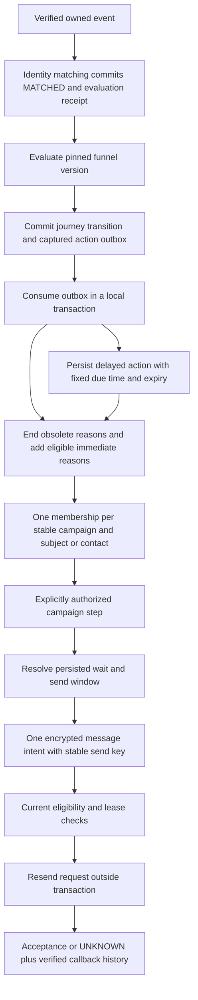
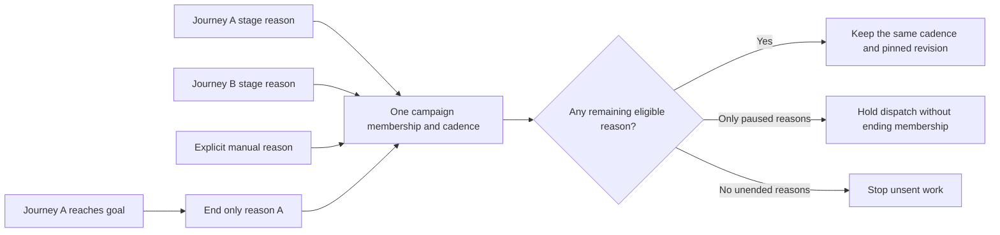
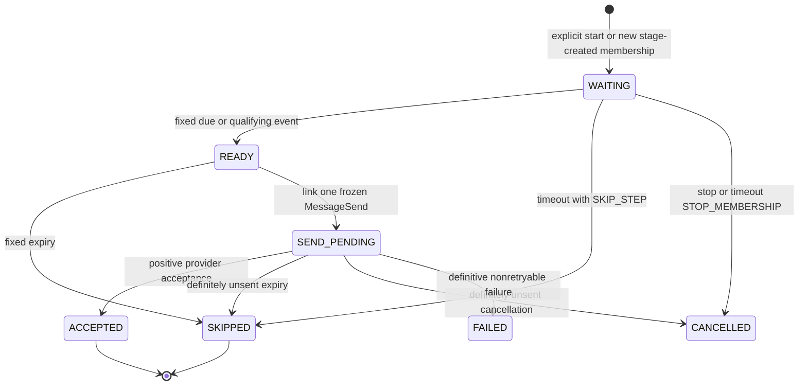
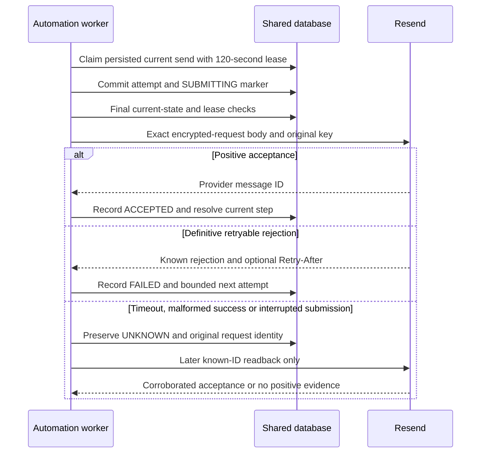
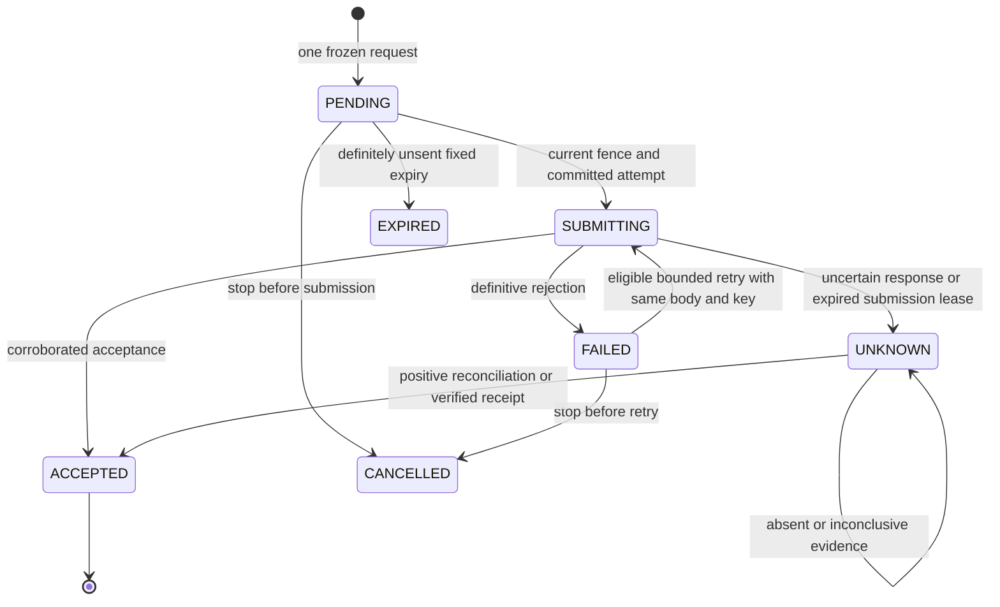

# Funnel and campaign automation

Operational contract for [issue #40](https://github.com/yohannesHL/marketing-app/issues/40). Implementation and fixture validation are in progress; the PR and required CI results will be recorded in [PROGRESS.md](../../proj/funnels/PROGRESS.md). Real provider and integrated live-pilot evidence remain pending.

This slice connects published funnel stages to LaunchPad-owned email campaigns. It implements explicit email enrolment and stop actions, durable campaign waits, sender verification, and delivery through the existing Resend message ledger. The visual builder belongs to #41. Paid advertising changes, general CRM tasks, arbitrary HTTP actions, remote provider sequences, reply detection, and automatic provider failover are not supported actions.

Read [the data/tracking contract](contracts.md) and [email setup](email-setup.md) first. Campaign links remain attribution only. An enabled `stageActions` entry is the separate authority to enrol or stop a campaign membership.

## From evidence to an email



A journey pins its funnel version. A membership pins its campaign revision; later reasons requesting a newer revision join that existing cadence. The active scope key contains the stable campaign ID and SUBJECT or CONTACT identity, never the revision ID. Automatic actions do not start another cycle after a membership finishes or stops. A new cycle requires explicit enrolment with `newCycle:true`, and unresolved possible acceptance keeps the previous scope occupied.

Each transition captures its normalized action plan and timing before the worker runs. Outbox consumption, action creation, reason replacement and first-step authorization commit locally without provider calls. A crash cannot turn an old stage entry into a new campaign or create a second send identity. Continuations are inserted in the same transaction that resolves their predecessor.

## Controls and upgrade behaviour

| Control or operation | Effect |
| --- | --- |
| Funnel `status:PAUSED` | Stops new journey entry; active journeys can continue tracking. It is not the dispatch switch. |
| Funnel `automationEnrolmentEnabled` | Allows future LIVE stage transitions to capture positive enrolment actions. Defaults to false. |
| Funnel `automationDispatchEnabled` | Allows that funnel's current stage reasons to authorize sending. Defaults to false. |
| Campaign `enrolmentEnabled` | Allows new manual or stage enrolments; a previously captured delayed action can wait for this control until its fixed expiry. |
| Campaign `dispatchEnabled` | Allows current eligible memberships to send. Turning it off preserves reasons and clocks. |
| Explicit membership `start` | Creates the first durable step authorization. It may be used while dispatch is paused or readiness is stale; it does not send or perform provider checks itself. Other recipient, campaign and connection eligibility still applies. |
| Stop, unsubscribe or deletion | Cancels unsent applicable work; preserves any possibly accepted external effect. |

Enabling automation is future-only. A transition committed while enrolment was disabled does not acquire an action when the switch is enabled later. Existing `TRACKING_ONLY` outboxes, historical stage associations and manual memberships are not upgraded by a worker scan. Adding an automatic stage reason to an existing manual membership without a cadence records `MANUAL_CADENCE_REQUIRES_START`; it does not silently start one.

An existing manual single-IMMEDIATE campaign can still use `/dispatch`. Timed or multi-step campaigns need `/start`. For a started membership, dispatch uses its current persisted step and cannot jump to a later step. Explicit start can adopt a compatible existing first send without changing its body, key or timing. Repeating the same start command returns its original authorization; changing the payload under the same key conflicts. A different command cannot start the same cadence twice.

New BACKFILL/REPLAY transitions may carry cancellation-only work. They cannot enrol recipients or release an EVENT sending wait. Manual moves remain tracking-only and apply negative reason cleanup immediately; they never create positive campaign actions.

## Configure explicit stage actions

Publish the campaign revision first, then reference its owned IDs in a funnel draft. Stage, campaign, revision, owner and TEST/LIVE environment must agree. Publish the reviewed funnel draft before enabling its controls.

The following is a fragment added to a complete version-1 funnel definition. `interested` and `booked` must already be declared stages; its routes determine when the subject enters them.

```json
{
  "campaignLinks": [
    { "id": "consultation-reporting", "stageId": "interested", "campaignId": "OWNED_CAMPAIGN_ID", "purpose": "ATTRIBUTION" }
  ],
  "stageActions": [
    {
      "id": "consultation-follow-up",
      "stageId": "interested",
      "kind": "EMAIL_ENROLL",
      "campaignId": "OWNED_CAMPAIGN_ID",
      "revisionId": "OWNED_PUBLISHED_CAMPAIGN_REVISION_ID",
      "delaySeconds": 0,
      "expiresAfterDueSeconds": 604800,
      "stopOnStageExit": true,
      "stopOnGoal": true
    },
    {
      "id": "stop-consultation-follow-up",
      "stageId": "booked",
      "kind": "EMAIL_STOP",
      "campaignId": "OWNED_CAMPAIGN_ID"
    }
  ]
}
```

`EMAIL_ENROLL` defaults to zero delay, seven days after due for action expiry, and both stop flags true. Its due time is `transition.recordedAt + delaySeconds`; action expiry is due plus its captured TTL. Action timing is separate from each message step's wait and TTL. The membership's first wait starts from its actual persisted enrolment time, after the action is applied.

`EMAIL_STOP` is immediate and ends only STAGE reasons owned by that same journey and campaign. It cannot stop an unrelated manual association or another journey's reason. Only one action for a particular campaign is allowed on one stage, preventing contradictory enrol/stop commands there. Conditions belong to funnel route branches; actions do not introduce another condition language.

Goal and terminal outcome remain separate. Reaching any goal in the same journey ends a reason with `stopOnGoal:true`, even if that journey later leaves the goal. A nonterminal purchased goal can still route to a refund stage. SUCCESS/FAILURE terminal journeys do not automatically start another cycle.

## Shared membership and cancellation



An immediate move between adjacent stages using the same campaign ends the outgoing reason and adds the incoming reason before settling the membership. The consumer applies accumulated outboxes for one journey in sequence inside that transaction, consulting the current stage, so a lagging consumer does not replay obsolete stage enrolments.

A delayed replacement deliberately does not keep the outgoing reason alive. If its last reason ends before the replacement becomes eligible, the membership stops; the delayed action reports that an explicit new cycle is required. Pauses do not reset its deadline or revive that cycle.

For CONTACT scope, stage reasons still retain their exact business journeys. Their sources and pending evaluation/outbox work participate in the send fence; an address is not used to guess a booking or order. An eligible independent manual or other-journey reason can retain a shared cadence when one reason is paused or ended.

Journey cancellation records an audited manual transition, ends that journey's stage reasons, cancels its pending actions/outboxes, and leaves independent reasons intact. A membership stop without `reasonId` ends the entire membership. A stop with `reasonId` removes only that association unless it was the last unended one. Unsubscribe and suppression apply by owner/environment/canonical address/category across memberships and providers.

A stop committed after a provider request begins cannot recall the message. The actual acceptance or uncertainty remains visible. No following step is authorized for a stopped membership, including after a late positive acceptance.

## Waits, clocks and send windows

Campaign revisions support 1–50 message steps. Each has one wait and a positive `expiresAfterDueSeconds` TTL, default seven days. Duration, timeout and TTL values are bounded to one year. DATE timestamps require an explicit offset.

| Wait | Due time or evidence interval | Next-step anchor after a local skip |
| --- | --- | --- |
| `IMMEDIATE` | First step: membership enrolment. Later step: predecessor's logical completion anchor. | Original due + TTL. |
| `DURATION` | Logical sequence anchor + `seconds`; elapsed seconds, not local calendar days. | Original due + TTL. |
| `DATE` | Exact configured `at`; it is never moved to worker restart time. | Fixed date + TTL, without moving the sequence backwards. |
| `EVENT` | Exact subject, configured source/type, optional typed EVENT-field condition; deadline is logical wait start + `timeoutSeconds`. | Original wait deadline for `SKIP_STEP`; `STOP_MEMBERSHIP` cancels the cadence. |

A successor's anchor is `max(previous.sequenceAnchorAt, previous.completedAt)`. Positive acceptance uses the provider acceptance time. Expired messages use their planned expiry; timed-out waits use their original deadline. A late worker skips definitely unsent expired steps in bounded local work instead of resetting their clocks and sending an old backlog. These rules also apply while dispatch is paused.

```json
{
  "kind": "EVENT",
  "sourceId": "OWNED_TRACKING_SOURCE_ID",
  "type": "custom.confirmation.ready",
  "anchor": "WAIT_STARTED",
  "timeoutSeconds": 86400,
  "onTimeout": "SKIP_STEP",
  "condition": {
    "field": { "scope": "EVENT", "key": "ready" },
    "type": "boolean",
    "op": "eq",
    "value": true
  }
}
```

This example releases the message after confirmation-ready evidence, not after a booking that should stop reminders. Use a funnel goal/exit or EMAIL_STOP for a negative booking condition. The source must allow the configured type and property key before campaign publication.

EVENT admission has all of these requirements:

- SUBJECT membership and the exact saved business subject; CONTACT campaigns cannot publish EVENT waits in this release.
- Original LIVE match receipt with its captured non-null source generation, still matching the current source and event. Historical receipts with unknown generation cannot qualify.
- Event occurrence at or after the selected search anchor and strictly before the deadline. `ENROLLED` searches from membership enrolment; `WAIT_STARTED` searches from the logical start of this wait. Both use the same wait-start-based timeout.
- Original match availability strictly before the deadline. A raw callback received earlier but first matched at the deadline loses to timeout. Equality is timeout for both occurrence and availability.
- A TRUE condition over the event's own fields. Missing, conflicting or wrong-type values do not qualify. PROPERTY references are not accepted in campaign EVENT waits.

The service checks durable qualifying evidence before settling a timeout, including after a late restart. A successful wait's due time is `max(waitStartedAt, original LIVE match availability)` and its TTL starts there. Later replay cannot erase a legitimate earlier LIVE receipt, and the replay receipt itself cannot qualify. Source rotation/unavailability blocks evaluation rather than inventing absence or rebinding the captured generation, even if the clock has passed the deadline. Resolved waits are checked again before a send; stale or redacted evidence cannot authorize it.

The immutable revision's named timezone, weekdays and minute range constrain actual submission. Windows are start-inclusive/end-exclusive; default Monday–Friday 09:00–17:00 UTC. Ambiguous local boundaries use the later occurrence, and daylight-saving gaps use the first valid instant. Waiting for a window never extends the fixed expiry. A message already possibly submitted is not declared unsent just because its window or expiry passes.



ACCEPTED/SKIPPED resolves the predecessor and creates its next WAITING row atomically, or completes the membership after its final step. UNKNOWN and SUBMITTING remain message states; the campaign step stays SEND_PENDING. No continuation or new cycle can pass that unresolved external effect.

## Uncertain stop evidence and current send checks

Before any send, the shared policy rechecks current campaign controls, applicable membership reasons, recipient binding, category consent, suppression, source/readiness, current step/evidence, lease, expiry and send window. Pending/failed evaluation receipts and unconsumed applicable transition outboxes hold relevant automatic dispatch, including CONTACT memberships through their associated journeys. Future delayed positive actions already materialized from an outbox do not block an unrelated eligible reason.

If a route that could exit the reason's stage or reach a stopping goal evaluates UNKNOWN, consuming its receipt does not make sending safe. A durable `STOP_CONDITION_UNKNOWN` hold remains. Every new effect captures immutable evaluation event ID, evaluated stage, journey revision and event occurrence time. Existing historical effects retain null metadata; migration does not manufacture current proof from them.

That hold clears only after a later definitive `FALLBACK_WAIT` evaluation of the same rule at the same stage/journey revision, with an occurrence at least as new, or a subsequent journey transition/audited manual correction changes the revision. Unrelated nonmatching evidence and older false evidence do not clear it. A definitive evaluation written in the same millisecond as the UNKNOWN record conservatively does not clear the hold; a later valid observation or an explicit audited correction is required. Unavailable stop-evidence sources also pause their reasons.

Do not bypass a hold by editing database evidence, changing immutable timing, or replaying a historical event as LIVE. Inspect source health and the journey history, correct the actual evidence, or use an explicit manual move/stop with a reason. Independent eligible reasons retain their own authority; one paused reason does not globally opt a contact out.

## Delivery leases and recovery



Worker authority derives from the owned persisted step/send and a random lease token whose hash is stored in the database. It does not impersonate a browser session. Existing manual PENDING sends without step authorization are not background-send candidates. Sender checks and submissions run outside SQLite transactions and revalidate their fences before provider requests.



An expired lease without submission can be released. An expired submission lease becomes UNKNOWN; it never resets to PENDING. A late positive result retains actual acceptance even after cancellation. Known retryable rejections use the same request/key and original provider binding, at most five total attempts, a 60-second exponential base capped at one hour, and any provider Retry-After floor. The original Resend idempotency horizon and message expiry still apply; retry does not extend either.

Automatic UNKNOWN reconciliation performs at most five actual known-candidate retrievals per send, with backoff. Missing candidate IDs produce `PROVIDER_ID_REQUIRED` and a deferred local check rather than a blind send or a provider read. A 404 or inconclusive result never establishes nonacceptance. Automatic exhaustion leaves UNKNOWN for explicit authenticated reconciliation; it does not release the scope. The manual reconcile endpoint can supply a provider message ID, but the response still must corroborate the frozen sender, recipient, content and opaque send reference.

Sender readiness has a separate 120-second durable lease shared with manual checks. Its cache lasts 15 minutes and is tied to source generation and credential version. Transient failures back off for at most five attempts; a permanent/exhausted check remains BLOCKED. A generation/credential change invalidates the cache, and an explicit authenticated readiness check can retry repaired setup. A readiness refresh cannot send an email or reset a campaign wait.

For source-rotated EVENT waits, the stored generation remains fixed. Inspect and explicitly stop/re-enrol a new cycle when appropriate; there is no automatic evidence rebind endpoint. A new cycle still cannot bypass UNKNOWN acceptance. For redacted/deleted contacts, automatic readback cannot reconstruct erased payloads; retained fingerprints continue preventing accidental resend.

## Run and inspect

Use Node 24.16+ in the Node 24 line, apply the Prisma migrations, and run all processes against the same persistent database. For local SQLite, `DATABASE_URL` must use an absolute file path; the automation worker rejects relative, in-memory and query-bearing SQLite URLs. Never run a worker against a temporary copy while expecting it to advance the app's records.

| Configuration | Purpose |
| --- | --- |
| `DATABASE_URL` | Shared persistent application database. |
| `APP_ORIGIN` | Exact public origin; HTTPS for live callback/unsubscribe setup. |
| `CONNECTION_TOKEN_KEYS`, `CONNECTION_ACTIVE_KEY_ID` | Existing credential vault keyring, also needed for retained frozen requests. |
| `EMAIL_LIVE_DELIVERY_ENABLED=true` | Separate deployment gate for LIVE email operations; leave disabled until the configured pilot is ready. |
| `FUNNEL_LIVE_INGRESS_ENABLED=true` | Separate LIVE tracking ingress/matching gate for the intended live sources. |
| `CONNECTION_MODE=mock`, `EMAIL_TEST_PROVIDER_ORIGIN` | Explicit loopback fixture transport for synthetic TEST. TEST never falls back to live Resend. |

```sh
npx prisma migrate deploy --config apps/web/prisma.config.ts
npm run automation:worker -- run-once
npm run automation:worker -- run
```

`run-once` performs bounded phases; it is not a promise to drain every queue. The command's runner processes one receipt-matching phase, tracking matching, funnel evaluation, stage-action consumption, stale send/refresh lease recovery, local step progress, due readiness/intent work, one send claim and one reconciliation claim. Independent `email:worker`, `tracking:worker` and `funnels:worker` processes may also run; database transactions, unique identities and leases coordinate their work. They do not become a second cadence implementation.

`run` polls when idle and stops cleanly on SIGINT/SIGTERM. Unexpected failures stop the process with a sanitized code and nonzero exit. Supervise it and inspect configuration, migration and storage health before restarting. Its console events contain phase/status, not recipients, payloads, token URLs or provider credentials. There is no automation `prune` command: use the existing `email:worker -- prune` and `tracking:worker -- prune` retention paths.

Matched tracking evidence remains pinned while its subject has an active journey or a non-ended authorized campaign cadence, including evidence a future ENROLLED wait may need. Deletion overrides personal-data retention, cancels future local work and redacts private notes/traces while preserving action/command/send tombstones and possible external acceptance. Completed outbox timestamps and execution outcomes cannot be rewritten by cleanup. Local erasure does not claim provider-side message deletion.

## Management API and previews

Management requests require a current customer session; mutations require exact `Origin: APP_ORIGIN`. Responses are private/no-store and JSON bodies are capped at 128 KiB. No HTTP request can supply worker authority or a lease bypass. See [email setup](email-setup.md) for connection, consent, suppression and webhook endpoints.

| Operation | Endpoint | Input or output |
| --- | --- | --- |
| Read/edit/publish funnel | `GET/PATCH /api/funnels/:id`; `POST .../:id/publish` | Draft `definition`, reviewed `draftRevision`; publish checks owned campaigns/revisions and sources. |
| Funnel automation switches | `PATCH /api/funnels/:id/controls` | `automationEnrolmentEnabled`, `automationDispatchEnabled`. |
| Campaign switches | `PATCH /api/marketing-campaigns/:id/controls` | `enrolmentEnabled`, `dispatchEnabled`, optional campaign status. |
| Enrol or explicitly start a new cycle | `POST /api/marketing-campaigns/:id/memberships` | Owned subject/contact, `requestKey`, `reason`; `newCycle:true` only for an explicit later cycle. |
| Start a manual membership's cadence | `POST /api/email/memberships/:id/start` | `{"requestKey":"STABLE_START_UUID","reason":"Start the reviewed follow-up sequence"}`. |
| Inspect cadence | `GET /api/email/memberships/:id` | Membership, reasons, current/history step rows, sends and `cadenceStarted`. |
| Stop all or one reason | `POST /api/email/memberships/:id/stop` | `reason`; optional `reasonId`. |
| Inspect journey | `GET /api/funnels/:id/journeys/:journeyId/history` | Pinned journey, transitions, evidence effects, actions and associations. |
| Cancel journey | `POST /api/funnels/:id/journeys/:journeyId/cancel` | Audited `reason`; independent membership reasons survive. |
| Manual tracking correction | `POST /api/funnels/:id/move` | `subjectId`, `stageId`, `reason`, `commandKey`, optional explicit `newCycle`. |
| Preview funnel routes/actions | `POST /api/funnels/:id/simulate` | Optional draft definition/current stage/control and up to 100 sample events. |
| Preview campaign timing | `POST /api/marketing-campaigns/:id/simulate` | Example below; draft or optional supplied definition. |
| Inspect/reconcile a send | `GET /api/email/sends/:id`; `POST .../:id/reconcile` | Safe attempt/receipt summaries; optional candidate `providerMessageId` for reconciliation. |

A campaign preview uses a fake clock and explicit sample eligibility:

```json
{
  "enrolledAt": "2026-10-19T09:00:00Z",
  "now": "2026-10-19T09:10:00Z",
  "eligibility": {
    "consent": true,
    "senderReady": true,
    "dispatchEnabled": true,
    "stopped": false,
    "waitSourceCurrent": true
  },
  "events": [],
  "acceptedAtByStep": {}
}
```

EVENT samples include `sourceId`, `type`, `occurredAt`, `availableAt`, `properties`, and optional `mode`, `sameSubject`, `sourceCurrent`. Supply acceptance timestamps by configured step ID only when deliberately simulating actual acceptance; READY is not ACCEPTED. The simulator reuses the condition/timing/window helpers and returns planned history with `externalEffects:false`. It does not read real provider readiness, authorize consent, create memberships/sends, or prove delivery. Funnel previews additionally show captured action timing and reason stops; use the same `evidenceKey` for copies of one canonical occurrence.

## Rollout and evidence

1. Apply the additive migration and verify the app and workers share the intended persistent database. Existing automation controls remain false and legacy records remain inert.
2. Configure synthetic TEST transport, source schemas, immutable campaign/funnel revisions and explicit consent. Exercise step timing, a booking/goal stop, unsubscribe, a dispatch pause, a restart and an uncertain-send fixture.
3. Inspect the persisted chain from source/event and pinned journey through captured action, membership reason, authorized step, frozen send and delivery attempt. Test the intended CONTACT/SUBJECT scope and adjacent-stage sharing.
4. Verify the simulator's sample assumptions against actual source/property configuration. Enable only the intended funnel and campaign controls; future-only enablement does not repair old entries.
5. Keep LIVE evidence pending until the intended account/domain/webhook configuration and authorized pilot recipient are available. Then record actual provider acceptance and verified callback correlation, with cancellation and duplicate-delivery observations, against the same persisted chain.

Fixture tests, code review, required CI, merge and a successful live pilot are separate evidence. See [PROGRESS.md](../../proj/funnels/PROGRESS.md) for recorded results; this guide does not mark issue #40 merged or live-validated.
