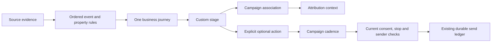

# Funnel workspace

The funnel workspace connects custom stages to recorded evidence and optional campaign actions. All pages use owned, environment-scoped APIs. TEST and LIVE remain separate. Provider and recipient pilot evidence is still required before claiming a live installation works.

## Start with a journey

Open **Funnels → Create funnel**. Choose whether a journey represents a person, an individual sales enquiry or a purchase. Two enquiries for one person remain distinct. Start blank or adapt the sales, ecommerce, event or subscription template. Templates are ordinary editable definitions, not fixed business stages.

The ecommerce template begins at verified payment and retains subsequent refund activity. Earlier website stages require evidence that can actually be matched to that purchase journey; a browser visit alone cannot prove payment. Event and subscription templates require the configured custom server events shown in their rules.



## Build with the canvas or forms

The stage list and forms provide the complete editing path without dragging. Add and name stages, choose allowed entry points, mark goals independently from successful/unsuccessful exits, and connect stages with source-qualified rules. Automatic routes form an acyclic graph; repeat journeys require explicit new cycles.

The React Flow canvas offers selection, dragging, connections, pan, zoom and automatic arrangement. Dragging a connection opens a source/event form. Canvas positions last for the current visit only. Saving stores business rules, not positions; arranging stages never changes branch priority.

The maintained `@xyflow/react` **12.12.0** package is pinned. Its [core is MIT licensed](https://github.com/xyflow/xyflow/blob/main/LICENSE); no Pro templates or subscription are required. Its [keyboard controls](https://reactflow.dev/learn/advanced-use/accessibility) supplement the complete form path. Automatic layout is a deterministic local projection of the saved DAG and adds no layout dependency.

For each rule, select a source before its allowed event and property fields. Add ordered branches and nested **all/any** conditions. Typed decimal values stay exact strings. Missing, null, conflicting and unavailable evidence are distinct: an earlier unknown condition waits instead of silently falling through. Fallback applies only after that route's trigger qualifies. Reorder routes and branches with their explicit buttons.

Removing a stage first lists affected routes, campaign links and actions. Incoming fallback paths become Wait; the editor never chooses a replacement business stage. Published versions remain unchanged. Incomplete typed values block saving and must be resolved before leaving their editor.

## Evidence and readiness

The selected stage's source inspector shows configured events and identity mappings, the latest received event, matching status and an exact link to its inbox entry. “Configured”, “received”, “matched” and automation prerequisites are separate observations. An idle source is not automatically broken. A received event is not proof that the expected subject was matched.

Open **Tracking sources** to configure native forms/browser measurement, signed server events, Calendly or Shopify. Identity mapping follows each supported adapter. Arbitrary transformations are not available. Setup responses show generated secrets/webhook URLs once; the stored source inspector never returns credentials. Replacing credentials or configuration advances the source generation and requires review of captured waits and queued evidence.

The inbox supports newest-first pagination and exact event inspection, explicit audited matching, history-only replay and supported provider reconciliation. Replay and backfill do not authorize new message campaigns. Calendly's optional correlation workflow binds the booking to one enquiry; a shared email address cannot identify which of two enquiries was booked.

## Campaign links and actions

Add one or more campaign links for attribution context. The campaign list can create PAID, SOCIAL and EXTERNAL references for this purpose; these references do not execute advertisements or posts. Links do not start a sequence. Separately add an explicit email enrollment/stop action, pin its campaign revision and choose its stage delay, expiry and stop conditions. The campaign owns message waits and send windows.

Open **Email campaigns** to configure a Resend connection and sender, create a campaign, choose subscription category and recipient scope, edit ordered messages and waits, publish, and manage separate enrollment/dispatch controls. Manual membership creation does not start a background sequence. **Start sequence** records explicit authority. UNKNOWN submission outcomes offer reconciliation instead of an ordinary resend.

The prerequisite observation uses stored provider checks and makes no provider calls. It reports missing campaign/source/sender setup and paused campaign controls. It does not grant consent or promise delivery. Each actual send rechecks current eligibility and sender freshness; the worker can refresh a previously configured sender when due work requires it.

## Save and publish

```mermaid
sequenceDiagram
    actor User
    participant Editor
    participant API
    participant Journey
    User->>Editor: Edit draft revision N
    Editor->>API: Save with expected revision N
    alt Another edit was saved
        API-->>Editor: Conflict
        Editor-->>User: Keep local edits; compare or download
    else Revision matches
        API-->>Editor: Saved revision N+1
        User->>Editor: Review publication
        Editor->>API: Observe prerequisites for saved revision
        Editor-->>User: Environment, subject, actions and future-only impact
        User->>API: Publish reviewed revision
        API-->>Journey: New entries use new version
        Note over Journey: Existing journeys keep pinned version
    end
```

Publication review only accepts the draft revision visible in the editor. A newer server draft must be compared/reloaded first. Local edits remain available after conflicts and can be downloaded. Control/status changes do not advance the editor's concurrency base.

Tracking-only publication requires no sender. Plans with unresolved action prerequisites can be saved while automation is off; activation checks the published configuration and carries the version reviewed in the workspace. A concurrent publication rejects activation until the newer version is reviewed. Publishing does not enroll historical contacts or migrate active runs. Pausing new automation, pausing pending dispatch, pausing new tracking entries and cancelling a particular journey have separate effects. Existing clocks do not reset on pause.

## Test and explain

**Test journey** evaluates the current draft with explicit sample events and times. A selected owned subject is context only; saved properties are not silently imported. Advance the sample clock, reuse an evidence key to simulate duplicate delivery, and choose LIVE/BACKFILL/REPLAY semantics. Results show matched rules, unknown/wait reasons, planned action times and cancellation reasons. No source, contact, campaign, provider or job is changed. Campaign simulation separately previews message waits and windows.

**People / journeys** keeps separate enquiries/orders and cycles visible. **Activity** shows the exact pinned version, occurrence/recorded times, source event, rule, manual reason, action status and associated campaign history. Inspecting an old cycle never silently targets a newer one: manual correction carries the displayed journey ID/revision and rejects a stale selection. A correction is tracking-only; cancellation cannot recall a message already accepted remotely.

## Verification and operations

Run `npm run test:e2e:funnels -- --project=chromium` for the dedicated isolated browser suite; Firefox and WebKit use the same command with their project names. The runner provisions a fresh migrated database and loopback email provider, explicitly disables LIVE transports and removes its resources at exit. It exercises the production application and public APIs rather than substituting browser API responses. Screenshots are retained under `test-results/funnels/` and CI artifacts. Set `QA_FUNNEL_TRACE=1` to retain browser traces on failure; video capture is disabled in this runner. The existing CI app-journey entry point also runs this isolated suite in each browser matrix job after the main suite succeeds. Targeted local `test:e2e` commands retain their existing scope. Fixture results are not live provider proof.

The workspace includes a persistent local Appearance selector for light/dark themes, visible labels, focus feedback, form alternatives to dragging and narrow-screen controls. See [tracking setup](tracking-setup.md), [email setup](email-setup.md) and [automation operations](automation-setup.md) for installation, worker, consent, reconciliation, retention and support procedures.

The original concept linked from issue #41 remains a prototype. Its fictional events are separate from the shipped pages and from actual provider evidence. Outcome reporting and the sales working board are delivered separately in #42.
