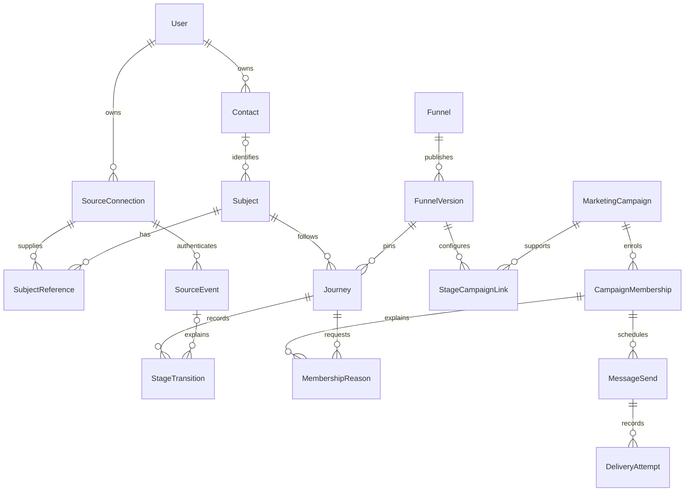

# Funnel data and tracking contract, version 1

Decision date: 17 October 2026. Implements the design deliverable in [#36](https://github.com/yohannesHL/marketing-app/issues/36), under [epic #35](https://github.com/yohannesHL/marketing-app/issues/35). This is the implementation contract for #37–#42; it does not claim these records or connectors are already deployed.

The user selected **LaunchPad forms/server API, Calendly, Shopify and Resend**, with LaunchPad owning email sequence timing. The remaining defaults below are explicit engineering decisions under the instruction to implement and merge the issues sequentially. A later change to these contracts requires a recorded revision and compatibility/migration decision.

## 1. Model choice and boundaries

Use an owned relational model with a durable event inbox and immutable funnel definitions. Keep the operational current stage separate from stage history and analytical facts.

Alternatives considered: (a) a mutable stage field on each contact cannot represent concurrent enquiries/orders; (b) putting the funnel inside a campaign prevents independent campaigns and tracking-only journeys; (c) a general executable workflow language introduces unnecessary execution and validation risk. Version 1 therefore uses declarative stage/condition/action configuration and a separate execution service.

`User` remains the authenticated customer account. `Contact` is a marketed-to record owned by that account, not another login. `Subject` is a business journey subject shared across funnels: a contact lifecycle, a sales enquiry/deal, or a purchase checkout/order. `Journey` is one run of one funnel for a subject. This additional subject identity lets two funnels refer to the same enquiry without merging two unrelated enquiries from the same contact.

Every new record has `ownerId`. Child references use owner-consistent composite foreign keys or equivalent database constraints, not merely application filters. Global UUID/cuid identifiers are opaque and never establish access. Lookup keys, query filters, idempotency and caches include owner and source/environment where applicable. Management APIs derive the owner from the current session and revalidate within mutations; webhook/API ingress derives it from the registered source.

### Proposed records and unique identities

| Record | Minimum identity/state | Required invariant |
| --- | --- | --- |
| `Contact` | id, ownerId, displayName, email/normalization status, createdAt | Email is a delivery address/hint, not global proof of person identity |
| `ContactIdentity` | ownerId, sourceId, namespace, externalId, contactId, verifiedAt/provenance | Unique `(ownerId, sourceId, namespace, externalId)`; external IDs are lossless strings |
| `SourceConnection` | id, ownerId, provider, externalAccountId, environment, status, generation, encrypted credentials, capabilities | Stable source identity across reconnect; distinct test/live sources; secrets excluded from DTOs/logs |
| `Subject` | id, ownerId, kind `CONTACT/SALES/PURCHASE`, optional contactId, createdAt | A repeat enquiry/order is a different subject; an anonymous purchase can have no contact |
| `SubjectReference` | ownerId, sourceId, kind, externalId, subjectId | Unique source-qualified reference; enquiry/deal/booking and checkout/order/refund links preserve provenance |
| `SourceEvent` | envelope below, digest, processing status, match reason | Durable accepted inbox; delivery dedupe and business-fact identity remain distinct |
| `Funnel` | id, ownerId, name, draft, publishedVersionId, status | Draft edits do not mutate a published version |
| `FunnelVersion` | id, ownerId, funnelId, version, schemaVersion, definition, digest, publishedAt | Unique funnel/version; immutable published content and stage IDs |
| `Journey` | id, ownerId, subjectId, funnelId, versionId, cycle, currentStageId, status, revision | One active journey per `(ownerId, funnelId, subjectId)`; explicit subsequent cycle |
| `StageTransition` | journeyId, sequence, from/to, version/rule, eventId or manual actor/reason, occurredAt, recordedAt | Append-only; unique journey sequence and qualifying event/rule effect |
| `MarketingCampaign` | id, ownerId, category, name, status, optional verified legacy reference | New owned identity; existing paid `Campaign` is not silently repurposed |
| `CampaignRevision` | campaignId, version, immutable content/cadence/sender/category | Enrolments pin a reviewed revision; editing cannot silently change queued messages |
| `StageCampaignLink` | ownerId, funnelVersionId, stageId, campaignId, purpose, action config | Link-only by default; purpose is attribution, audience or enrolment |
| `CampaignMembership` | campaignId, campaignRevisionId, scope key, cycle, status | Unique active membership per stable campaign and declared scope; revision is pinned |
| `MembershipReason` | membershipId, journeyId, link/actionId, active, stop reason | Distinct ownership of each enrolment reason across funnels |
| `AutomationJob` | version, journey/subject, actionKey, dueAt/deadline, state, lease/revision | Atomic intent/outbox with transition; claim/run/attempt history survives restarts |
| `MessageSend` | membershipId, stepId, iteration, payload digest, provider/source, idempotency key, external ID, status | One local send intent per membership/step/iteration; no blind provider failover |
| `DeliveryAttempt` | send/job, attempt number, submittedAt, outcome, sanitized error | Unknown acceptance is distinct from definite rejection |
| `SubscriptionState` | ownerId, canonical delivery address, category, state, reason, provenance, changedAt | Unknown is not marketing consent; switching providers cannot remove an opt-out |

The first schema implementation may combine small records where the invariants remain enforced; it must not discard subject separation, source-qualified identity, immutable versions, membership reasons or attempt evidence.

## 2. Identity and matching contract

Resolve in this order: a verified existing source/business reference; a valid server-issued opaque journey/subject reference carried by the source; an explicit authenticated/manual association. Contact matching alone never chooses among multiple enquiry/order subjects. A form can create a new contact and subject; a subsequent form needs an explicit known contact reference to associate confidently. Do not merge automatically by email, name, IP, timestamps or a forwarded campaign link. Email matches may be offered as review suggestions.

Anonymous browser IDs are random, source/owner scoped and distinct from contact IDs. A browser's claimed internal contact/subject ID is untrusted. Accepted native form submissions can link a scoped anonymous visit and the newly created enquiry, with the captured source context. Browser activity can supply observations but cannot establish a paid order or recorded sale.

An ambiguous event remains `UNMATCHED` with candidate references and a sanitized reason. A manual match is audited and can repair reporting; it defaults to history-only evaluation. Contact merges are explicit, owner-scoped, reversible by audit where possible, and must retain external references/history without replaying old automation. Full merge UI is deferred; silent merging is prohibited.

### Required examples

- Maya's enquiries `enquiry_A` and `enquiry_B` have distinct SALES subjects and journeys, even if they share a contact. Booking A must not stop B's follow-up.
- Maya's checkout token `checkout_one` and confirmed `order_101` refer to the same PURCHASE subject only when the verified store payload establishes that link. `order_102` creates a new subject/journey.
- A paid order without a checkout token remains a valid purchase subject with unknown pre-purchase attribution; do not invent missing visits or contact identity.
- Two customer accounts may receive the same external string `order_101`; their source, subject, event, journey and campaign records remain isolated.

## 3. Normalized event envelope

This is a **server-created internal envelope**. Public clients cannot set owner, authority, verification, environment, processing status or resolved IDs. See [example envelopes](event-examples.json).

| Field | Contract |
| --- | --- |
| `schemaVersion` | Integer `1`; reject unsupported versions with a recoverable diagnostic |
| `id`, `ownerId`, `sourceId` | Generated/resolved by the server; source ownership checked before processing |
| `environment` | `TEST` or `LIVE`, from source registration; never combine them in reports/actions |
| `ingestionMode` | `LIVE`, `BACKFILL`, `REPLAY`, `SIMULATION`; only explicitly eligible live events may create external action intents |
| `provider`, `providerTopic`, `providerApiVersion` | Source provenance; optional provider API version preserved when present |
| `providerDeliveryId`, `providerEventId` | Optional strings, not interchangeable; absence is valid |
| `dedupeKey`, `dedupeKeyVersion` | Adapter-defined stable key and version, scoped by owner/source/normalized type; required even without a provider UUID |
| `factKey` | Optional canonical business fact key; independent of delivery identity |
| `type` | Catalogued canonical type, or source-approved `custom.*` type |
| `resource` | `{kind, id}` plus related source resource references; values are strings, never lossy numeric IDs |
| `occurredAt`, `receivedAt`, `resourceUpdatedAt` | UTC timestamps; receipt time is server-generated, resource version time optional |
| `authority` | `BROWSER_OBSERVED`, `SERVER_ASSERTED`, `PROVIDER_VERIFIED`, `USER_RECORDED`, assigned by trusted ingestion code |
| `verification` | Method/key version and outcome, without signatures or secrets; only accepted authentication reaches trusted processing |
| `subjectId`, `contactId`, `anonymousId` | Optional resolved internal identity; raw external references remain separate matching evidence |
| `references`, `journeyReference` | Source-qualified external keys and optional opaque correlation token; token validity and ownership must be checked |
| `campaignContext` | Captured campaign/send/source/UTM references with provenance; no inferred causal claim |
| `normalizationVersion`, `rawPayloadDigest`, `attributes` | Versioned normalization, SHA-256 raw digest and validated allowlisted properties |

Money is a decimal string plus ISO currency, never a binary floating-point number. Preserve shop and presentment currencies separately. Conversion to integer minor units requires the currency's exponent and an overflow check. Reporting never adds different currencies implicitly.

### Acceptance, deduplication and ordering

Persist verified accepted events before acknowledging durable receipt; then evaluate asynchronously. Native forms persist their accepted submission and event atomically. Store a delivery key unique per owner/source/type, with its digest. Same key/same digest is an idempotent receipt. Same key/different content is a visible conflict requiring reconciliation; it is not silently overwritten.

Multiple deliveries can describe one fact. Normalize canonical order/payment/refund/booking keys separately, retain evidence, and choose authority by the configured event/source capability, not by trusting a body field. Deduplicating all topics solely by a provider event ID is invalid. Browser and server observations merge analytically only with a verified shared business reference.

An old checkout event may enrich history but cannot regress a paid journey. Source update/version metadata determines whether a state snapshot supersedes another; ingestion order alone does not. Refunds, reschedules and corrections are explicit events and paths. Future timestamps outside the configured clock-skew tolerance are quarantined. Backfill/replay updates allowed history and reporting without sending; a later identity match is not a new live occurrence. History-only means no new external action or campaign enrolment: verified reconciled current facts may still invalidate/cancel pending work. A recovered booking or opt-out must stop now-ineligible reminders, even though it cannot start retrospective campaigns. Reconciliation must preserve evidence and check source ordering before superseding current state.

## 4. Initial source contracts

| Source | Minimum inputs and normalized events | Identity and verification | Capability boundaries |
| --- | --- | --- | --- |
| Native form | Accepted server-side submission → `enquiry.accepted`; optional consent evidence and scoped anonymous visit | Server-generated enquiry ID; form/source ownership; accepted submission idempotency | A browser form cannot declare `order.paid` or `deal.won` |
| Server API | Versioned allowlisted custom events plus source-approved business events | Scoped secret/HMAC authentication, replay control, request fingerprint; server-assigned owner/authority | Credentials grant only configured types; no arbitrary property/code execution |
| Website SDK | `page.viewed`, `product.viewed`, `checkout.observed` | Public source/site key, allowed origins and rate/payload limits; lower trust | Domain allowlist is not authentication; no authoritative financial events or internal-ID claims |
| Calendly | `invitee.created` → `booking.confirmed`; `invitee.canceled` → `booking.cancelled`; preserve reschedule links | Invitee URI is the booking key; event URI is separate. HMAC-SHA256 over `timestamp.rawBody`, configured freshness, signing key required | No documented universal delivery UUID; dedupe created/cancelled facts by topic + invitee URI. Tracking-field journey correlation must be proved, not assumed |
| Shopify | Order paid → `order.paid`; refund created → `refund.created`; successful refund transaction → `refund.succeeded` | Verify raw-body HMAC; preserve shop, order/refund/transaction IDs, webhook ID and event ID | A Refund record is not money-returned evidence. Use `checkout_token` ↔ `token`, not removed checkout IDs |
| Resend | Message accepted/sent/delivered/delayed/bounced/complained/failed/suppressed; optional engagement and provider suppression changes | Verify Svix headers/raw body; provider email ID maps to our persisted one-recipient send; tags carry opaque send reference | Open/click is not payment/booking proof. Provider suppression removal does not clear local unsubscribe |
| Manual update | Authorized stage move or recorded sales outcome | Current session/owner, actor, reason and event ID | Default tracking-only; explicitly selected actions still recheck eligibility |

Register sources independently of the existing ad `Platform` enum. Use the existing credential vault with owner/source/field authenticated context, generations and rotation. Do not expose raw provider tokens through browser-readable settings. A source's declared types/capabilities are server-controlled and reflect implemented operations.

Calendly requires a supported account/plan, scopes and a signing key. A reschedule creates/cancels invitee records with old/new links; preserve them even when callbacks arrive out of order. Without adequate correlation, retain the booking unmatched. Webhook delivery retries and future-only subscription behaviour do not replace reconciliation.

Shopify uses lossless source-qualified IDs. Preserve `X-Shopify-Webhook-Id` for delivery identity and `X-Shopify-Event-Id` for merchant-action correlation, scoped by topic. Confirm refund transaction kind/status/currency and distinguish test transactions. Orders without checkout/customer data remain valid. Older order access and protected-customer-data access depend on approved scopes.

Resend provides a **24-hour idempotency window**; local send identities and request digests must live longer. A provider timeout is not proof of rejection. After an unknown outcome and expired provider dedupe window, reconcile or surface manual recovery instead of sending again. LaunchPad owns waits and submits only when due. Cancelling a provider-scheduled email is distinct from recalling a sent message; provider scheduling is not required in v1.

Official contracts checked 17 October 2026: [Calendly signatures](https://developer.calendly.com/api-docs/overview/webhooks/webhook-signatures), [rescheduling](https://developer.calendly.com/docs/api-guides/see-how-webhook-payloads-change-when-invitees-reschedule-events), [Shopify webhook verification](https://shopify.dev/docs/apps/build/webhooks/verify-deliveries), [checkout identifier change](https://shopify.dev/changelog/posts/removed-checkout-id-from-checkouts-and-orders-webhooks), [Refund](https://shopify.dev/docs/api/admin-graphql/latest/objects/Refund), [Resend idempotency](https://resend.com/docs/dashboard/emails/idempotency-keys), [webhook verification](https://resend.com/docs/webhooks/verify-webhooks-requests), [suppression](https://resend.com/changelog/suppression-list-support).

## 5. Funnel definition and execution policy

Version 1 supports a directed acyclic automatic stage graph, ordered exclusive outgoing conditions and an explicit fallback. Each condition is typed declarative data using allowed fields/operators and nested all/any groups; no JavaScript or SQL expressions. A funnel has a subject kind, configurable allowed entry stages, goals and unsuccessful exits. Templates are editable examples. Tracking-only stages require zero actions.

Automatic loops are deferred. This is an explicit first-version execution limit, not a template restriction. Audited manual return/correction is supported without rewriting history; by default it produces no actions. Starting another completed cycle requires an explicit operation/policy. A different enquiry/order is a new subject and can start independently. An active run cannot be duplicated by publishing another version.

Default publication processes future qualifying events, with `occurredAt` at or after activation. Existing matching records and historical events remain measurement-only unless a separate explicit enrolment operation is provided. Existing journeys pin their version; new journeys use the currently published version. Deleting/editing a draft stage cannot rewrite active history. Version migration is deferred; stopping old runs and starting deliberately reviewed new runs is the supported alternative.

Record each transition, rule/evidence and corresponding optional action intent atomically. Repeated evaluation of the same event/rule/journey cannot emit another intent. The simulator uses the same pure condition/transition semantics and a fake clock with an effect-free output collector.

### Campaign membership and stop ownership

New `MarketingCampaign` identities are owned and categorized `EMAIL`, `PAID`, `SOCIAL` or a declared external integration. A stage association may attribute traffic, identify an eligible audience, or enrol in a supported campaign. Attribution is the default. No stage entry launches a whole ad campaign, broadcast or social post.

Email membership defaults to **SUBJECT scope**: one active membership per stable campaign/business subject, with a pinned revision and explicit cycle, with separate reasons for each requesting journey/link. Two funnels supporting the same enquiry share the membership; separate enquiries remain independent. If a second link requests a newer campaign revision while a membership is active, keep the existing pinned revision and report that choice; do not start a parallel sequence. A later explicit cycle can use the newer revision. An explicitly chosen CONTACT-scoped campaign may share one membership across a contact's subjects. Anonymous subjects cannot enrol for email.

Leaving a stage removes its own membership reason. Stop the membership when no eligible reasons remain, when an explicit campaign-wide stop applies, or when recipient suppression overrides it. Suppression is keyed by owner, canonical delivery address and subscription category, independently of contact IDs and providers. For suppression comparison, trim whitespace and case-fold the complete email address; do not strip dots or plus suffixes. This conservative delivery block does not merge identities. A new contact using an already opted-out address remains blocked. An address opt-out overrides every reason/provider for the relevant category. Do not silently stop another active enquiry because one funnel ended.

The campaign owns message cadence; automation owns enrolment, stopping and separate business actions. Pin campaign revisions. Define `MessageSend` before network submission and keep exact request fingerprint/idempotency key and provider acceptance evidence. Sender changes do not migrate uncertain sends to another provider.

### Action and source capability matrix

| UI operation | V1 disposition |
| --- | --- |
| Connect campaign for attribution | Supported association; never a send |
| Enrol/stop supported email campaign | #39/#40, explicit enablement, known recipient and eligibility |
| Delay, wait for event with timeout, conditional branch | #40; event wait starts at declared time and has a persisted deadline/fallback |
| Manual stage movement | #38/#41; owner/actor/reason, tracking-only default |
| Paid audience sync, task creation, inbox reply detection | Deferred until concrete adapter/data capability exists |
| Launch/pause entire ad campaign or scheduled social publication on contact entry | Outside funnel action catalogue |
| External marketing-platform sequence enrol/stop | Deferred adapter capability; a raw Resend send API is not this interface |
| Arbitrary code or unlimited automatic loops | Unsupported |

## 6. Operational and lifecycle decisions

| ID | Decision and rationale | Owner/date |
| --- | --- | --- |
| D01 | Native form/API + Calendly + Shopify + Resend; LaunchPad owns cadence. User-selected initial integrations. | User, 2026-10-17 |
| D02 | Existing single `User` customer boundary; team workspaces/roles deferred. Avoid inventing authorization scope. | Engineering default, 2026-10-17 |
| D03 | Subject distinct from contact and funnel journey; explicit source-qualified matching only. Concurrent enquiries/orders stay independent. | Engineering default, 2026-10-17 |
| D04 | New owned marketing identity; preserve legacy paid campaign records and SQL category constraint. | Engineering default, 2026-10-17 |
| D05 | Automatic DAG, ordered exclusive branches/fallback; explicit new-cycle re-entry; immutable versions pinned to active runs. | Engineering default, 2026-10-17 |
| D06 | Future-only publication; backfill/replay/manual repair measurement-only by default. Avoid retrospective campaigns. | Engineering default, 2026-10-17 |
| D07 | SUBJECT membership with multiple reasons and one active slot per stable campaign/scope; revisions stay pinned. CONTACT scope explicit. Stage exit removes only its reason; suppression overrides all. | Engineering default, 2026-10-17 |
| D08 | Marketing subscription starts UNKNOWN; sending requires current positive eligibility. Record purpose/source/time. Bounces/complaints and opt-out have distinct reasons. No automatic resubscribe from a provider callback. | Engineering default, 2026-10-17 |
| D09 | Store UTC instants + campaign IANA timezone. Default timezone UTC is visible and editable. Default send window 09:00–17:00 weekdays; ambiguous local time uses the later occurrence, nonexistent time advances to the first valid instant. | Engineering default, 2026-10-17 |
| D10 | Pause new enrolment and pause dispatch are separate; tracking/timeouts continue. Resume rechecks eligibility, skips messages past an explicit expiry, and applies the next valid send window. Cancel does not recall accepted sends. | Engineering default, 2026-10-17 |
| D11 | Raw payload retention 7 days, normalized unmatched/event detail 180 days, transition/send evidence 365 days, configurable per deployment. Pruning must preserve needed in-flight work and durable minimal dedupe/suppression tombstones. Report coverage changes when history expires. | Engineering default, 2026-10-17 |
| D12 | Customer deletion cancels work, removes recipient payloads and external mappings, and prevents replay from recreating sends. Retain only minimal justified owner-scoped suppression/idempotency evidence under the configured deletion policy; do not claim provider deletion from local deletion. | Engineering default, 2026-10-17 |
| D13 | Local action identity plus provider idempotency within its actual window; uncertain external outcomes reconcile before retry. Never promise universal exactly-once delivery. | Engineering default, 2026-10-17 |
| D14 | Reuse social worker protocol and shared storage/security primitives, with separate funnel/email records. Avoid coupling workflow execution to social media/upload models. | Engineering default, 2026-10-17 |

Deployment evidence still required: actual Calendly scopes/signing/correlation, Shopify installation/scopes/refund transaction access, Resend domain/key/webhook setup, an authorized pilot recipient, and policy settings for real customer data. These are visible rollout prerequisites, not inferred from a merged PR. Test mode uses isolated synthetic fixtures and cannot fall back to live endpoints. Code, fixture validation and live pilot completion have separate statuses.

## 7. Existing data migration and infrastructure reuse

Reconciled against remote `main` **802050e96242ae443c95f857ca5d244f1f7dac17**. The prior local review was based on an older dirty checkout. Current main includes customer and provider work in PRs #19–#24, social scheduler #26, social UI/provider work #27–#32, QA #33 and release documentation #34. Their owner/live gates remain independent of merge status.

- Existing `Campaign` has no owner and its social migration enforces `category = PAID_ADVERTISING`. Do not change that table's category meaning. Create new owned campaign identities; link a legacy record only after every relevant linked account yields the same verified customer owner. Mixed/unowned records remain inaccessible historical data until an audited migration resolves them. Never assign an owner from the session running a migration.
- Persisted `AdProxyExecution` is an execution log, not a contact campaign lifecycle. Nullable historical owners do not grant current access.
- `SocialDeliveryWorker` has transactional leases, attempts, cancellation, retry and UNCERTAIN reconciliation. It is tied to social revisions, variants, media, destinations and provider costs; use its protocol for separate automation records, extracting shared code only when beneficial and tested.
- `ConnectionOperation` is a permission gate. Reuse vault/AAD, generation/version fences, owner-safe errors and the `LocalSqliteAdapter`; do not treat the operation record itself as a scheduler.
- Add forward-only dated migrations and preserve existing CHECKs/triggers. No reset or modification of earlier migrations. New composite owner foreign keys, uniqueness and immutable definition/history constraints require direct database validation.
- Web and worker processes share the same absolute persistent SQLite path and supported Node 24.16+ runtime. Transaction callbacks and provider calls must never be replayed by a contention retry. Use the existing adapter's write-intent and bounded COMMIT handling.

Evidence: `apps/web/prisma/schema.prisma`; `20261013030000_social_publishing/migration.sql`; `apps/web/src/server/social/deliveryWorker.ts`; `postService.ts`; `apps/web/src/server/prisma/localSqliteAdapter.ts`; [social delivery operations](../social-delivery.md); [current release packet](../social-release-packet.md).

## 8. Delivery sequence and validation

#37 implements owned source/contact/subject/event storage, authentication/normalization, matching, diagnostics and the first real source adapters. #38 adds definitions/rules/history. #39 adds owned email campaign/sender/membership/send records. #40 adds durable automation and shared scheduling behaviour. #41 builds the canvas/inspector/simulator. #42 adds reporting and integrated evidence.

Each issue gets a separate reviewed PR, required checks and merge before the next implementation branch. Tests must cover two owners with repeated external IDs, two enquiries for one contact, repeat orders, missing/ambiguous identity, changed-payload idempotency conflict, duplicate cross-source purchase evidence, late events, reschedule, successful versus pending refund, restart/concurrent claims, suppression and uncertain acceptance. Use real isolated SQLite and protocol fixtures; no developer database or live recipient is a test fixture.

Issue #36 is complete when this contract, its concrete examples and the reconciled dependency inventory are reviewable. Runtime/migration/provider acceptance belongs to the respective implementation issues. The epic is complete only when its required integrated evidence is actually established; a diagram, mock success or merged issue alone is insufficient.
