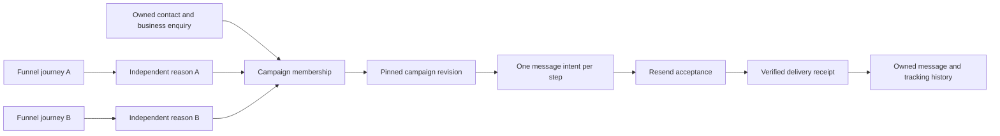

# Owned email campaigns

Implementation guide for issue #39. Automatic stage actions and timed sequences are tracked separately in #40.

LaunchPad owns the campaign definition, recipient membership, message intent, consent and unsubscribe policy. Resend delivers each submitted email. A campaign association on a funnel stage records attribution; it does not enrol a recipient or start an entire broadcast. Automatic stage actions and timed multi-step execution belong to issue #40.



The default membership scope is the business subject. Two funnels supporting the same enquiry share one membership in the same stable campaign. A separate enquiry or order can have its own membership. CONTACT scope is an explicit campaign choice. Changing a campaign draft or provider never creates a parallel membership for an already active scope. A later reason that requests a newer revision joins the existing pinned revision and reports that choice.

## Setup

Use the same persistent absolute database path and supported Node runtime for the web app and workers. Configure the existing credential vault keyring in the deployment secret store. Do not put API keys or webhook secrets in issue comments, URLs, browser storage or command output.

1. Create an email connection in the intended TEST or LIVE environment. Initial setup can save the API key before the webhook exists. LaunchPad returns its high-entropy webhook URL once and retains only its token hash and exact URL digest.
2. Create the Resend webhook using that URL, then save its provider webhook ID and signing secret on the LaunchPad connection. If the URL is lost, rotate it and update the provider endpoint before rechecking readiness.
3. Add the sender address, optional name/Reply-To and its Resend domain ID. Sender headers are immutable identities; create another sender to change them.
4. Check sender and webhook readiness. LaunchPad validates the exact sender domain, fully verified status, enabled sending capability, endpoint URL, signing secret and required event subscriptions. A stored credential or enabled sending flag alone is not readiness.
5. Create a campaign with explicit subscription category, sender, content, timezone and send window. Publish the reviewed immutable revision, then enable new enrolments and dispatch separately.
6. Record recipient consent with purpose, evidence source and time. An address alone, a website event, an open or a click does not grant marketing consent.
7. Explicitly enrol an owned recipient subject/contact with an idempotent command and reason. For issue #39, publish one IMMEDIATE message and dispatch it explicitly. Automatic scheduling is introduced in #40.

Initial Resend setup requires a full-access API key because sending-only keys cannot perform all readiness and reconciliation reads. LaunchPad's fully verified-domain requirement is deliberately conservative; some partially verified domains can send through Resend but remain unavailable under this first policy. No domain creation or DNS mutation is performed by these checks.

TEST uses explicit synthetic provider fixtures and cannot fall back to live Resend. Resend's `@resend.dev` testing addresses use real authenticated provider calls and consume provider quota; they are not the synthetic environment. LIVE delivery is separately gated by deployment configuration and current recipient eligibility.

## Sending and cancellation

```mermaid
sequenceDiagram
  participant U as Authorized action
  participant D as Durable database
  participant R as Resend
  participant H as Signed callback
  U->>D: Enrol reason; pin campaign revision
  U->>D: Persist encrypted exact request and send key
  U->>D: Check eligibility and commit submission attempt
  U->>D: Final current-state fence
  U->>R: Send exact body with stable idempotency key
  par Acceptance response
    R-->>U: Provider message ID or uncertain outcome
    U->>D: Preserve accepted or unknown result
  and Callback may arrive first
    R->>H: Signature-protected message event
    H->>D: Persist and deduplicate receipt
  end
  D->>D: Bind owned provider ID to one local send
```

Before submission, LaunchPad checks current ownership, membership reasons, campaign dispatch control, recipient address, positive category consent, all applicable suppression reasons, sender/connection readiness, expiry and send window. Provider calls occur outside transactions. An accepted email remains accepted even if a stop commits during the network request; its cancellation request is recorded, but remote recall is not promised.

Unsubscribe is owner/environment/address/category scoped across contact IDs and providers. Trimming and case-folding the whole address is only a suppression comparison, not identity merging; plus suffixes and dots are preserved. Hard bounce, complaint and provider suppression are separate global marketing holds. A provider removal callback cannot resubscribe someone or clear a local opt-out.

GET on the opaque unsubscribe link only displays confirmation. Its token-authorized POST records opt-out without dashboard login or a same-origin requirement. This also supports the one-click email header. No personal data appears in the URL. Repeated opt-out is idempotent and cancels applicable unsent work across providers.

## Uncertain outcomes

A timeout, process crash after the submission marker, malformed successful response or idempotency conflict is not proof of rejection. The local send retains its exact payload, recipient, provider binding and key. An unknown send cannot free its membership slot or move to another provider.

Resend retains idempotency keys for 24 hours; LaunchPad retains its local send identity longer. Explicit retries of known retryable rejection use only the original request and key, within the stored provider window and after all current eligibility checks. UNKNOWN outcomes require positive reconciliation and are never blindly resent. A 404 or empty listing does not establish nonacceptance.

Reconciliation retrieves a known or explicitly supplied candidate provider message ID through the original connection. It must corroborate recipient, sender, subject, supplied content and opaque send reference. A callback tag alone cannot bind an unrelated message. Resolving old acceptance does not require current marketing consent and never sends an email.

## Evidence and retention

Message acceptance and delivery are separate. Late sent/delayed notifications cannot erase bounce, complaint or suppression. Opens and clicks are limited engagement signals, never proof of booking or payment. Each signed receipt retains its own occurrence and receipt time. The same delivery ID with changed content returns a conflict and increments its retained conflict count without overwriting the original. Pending evidence is quarantined; already matched history remains intact.

A SUBJECT-scoped message can produce trusted evidence for its explicitly saved subject. CONTACT-scoped delivery history does not select an arbitrary sales enquiry. Historical replay/readback may repair history or cancel ineligible work, but cannot create retrospective campaign enrolment.

Local contact deletion cancels outstanding work and redacts recipient payloads and external mappings while preserving the minimum policy/idempotency evidence required to prevent replay resurrection. Local deletion does not claim deletion of provider-held messages. In-flight work and unresolved acceptance must be preserved by retention rules.

Fixture tests, code merge and live pilot completion are separate evidence. A live pilot requires configured account/domain/webhook access, an authorized recipient and a persisted contact/journey/campaign/step/send chain with actual acceptance and verified callback correlation. Until those are recorded, live proof remains pending in the issues.

## Deployment and HTTP operations

Set `EMAIL_LIVE_DELIVERY_ENABLED=true` only for an explicitly configured LIVE deployment. `APP_ORIGIN` must be the exact public HTTPS origin for live unsubscribe links and callbacks. The existing `CONNECTION_TOKEN_KEYS` and `CONNECTION_ACTIVE_KEY_ID` keyring encrypts connection credentials and frozen send requests. Never rotate away a key still needed by retained records without migrating those records.

For synthetic TEST transport, set `CONNECTION_MODE=mock` and `EMAIL_TEST_PROVIDER_ORIGIN` to an explicit HTTP loopback fixture origin. Without both, TEST provider operations report `EMAIL_TEST_PROVIDER_UNAVAILABLE`; they never use the live Resend API. The automated tests inject a local fixture transport and require no real API key. A TEST record is not evidence of a real Resend test-address delivery.

Run the receipt worker against the same persistent database as the app:

```sh
npm run email:worker -- run
npm run email:worker -- run-once
npm run email:worker -- prune
```

The worker verifies already-ingested receipt mappings and applies policy/tracking effects. It does not submit campaign messages in #39. Also run `tracking:worker` for website/business evidence and `funnels:worker` for journey evaluation. Configure the existing vault and `APP_ORIGIN` for worker startup, and use an absolute SQLite `DATABASE_URL` when using local storage. Workers stop on unexpected failures with a sanitized code; supervise and restart them after investigating configuration/database health.

`prune` processes bounded batches of up to 200 records per category. Run it regularly; repeat while counts remain nonzero. Normalized receipt details expire after 180 days. Finished send payloads/raw provider mappings, ended reason notes and policy-audit prose default to 365 days (`EMAIL_SEND_RETENTION_DAYS`, integer 1–3650). Keep minimal send/receipt fingerprints, IDs, attribution, subscription/suppression and unsubscribe tombstones. Queued callbacks retain their required policy effects until processed, and also pin their connection’s finished send payloads. Unknown/submitting acceptance and in-flight attempts preserve reconciliation evidence; an unresolved send conservatively pins its connection's expired receipts. Clearing a retention interval does not cancel work or prove remote deletion. Account deletion remains a separate operation.

All management requests below require the current customer session. Mutations also require exact `Origin: APP_ORIGIN`. Responses use `Cache-Control: no-store`. JSON bodies are capped at 128 KiB; unsupported fields fail validation.

| Operation | Endpoint | Important input |
| --- | --- | --- |
| List/create connections | `GET/POST /api/email/connections` | GET `environment=TEST\|LIVE`; POST `name`, `environment`, `apiKey` |
| Inspect/update connection | `GET/PATCH /api/email/connections/:id` | PATCH `apiKey`, `webhookSecret`, `providerWebhookId`, `status`, `rotateIngress:true` as needed |
| Inspect/add sender | `GET/POST /api/email/connections/:id/senders` | `address`, `domainId`, optional `name`, `replyTo` |
| Verify readiness | `POST /api/email/connections/:id/check` or `/api/email/senders/:id/check` | Read-only provider checks; no send |
| List/create campaigns | `GET/POST /api/marketing-campaigns` | GET environment; POST example below |
| Read/update draft | `GET/PATCH /api/marketing-campaigns/:id` | PATCH `draftRevision`, `definition`, optional `name` |
| Publish revision | `POST /api/marketing-campaigns/:id/publish` | `draftRevision` |
| Separate controls | `PATCH /api/marketing-campaigns/:id/controls` | `enrolmentEnabled`, `dispatchEnabled`, optional `status:ACTIVE\|ARCHIVED` |
| View/update recipient policy | `GET/POST /api/email/policy` | GET `contactId`, `category`; POST audited command below |
| List/enrol membership | `GET/POST /api/marketing-campaigns/:id/memberships` | POST `subjectId` or explicit CONTACT `contactId`, `requestKey`, `reason`; optional owned `journeyId`, `revisionId`, `newCycle:true`; GET optional cursor |
| Inspect/stop membership | `GET /api/email/memberships/:id`; `POST .../:id/stop` | Stop `reason`, optional `reasonId` to remove only one reason |
| Explicit first send | `POST /api/email/memberships/:id/dispatch` | `{}`; persisted first intent reused |
| Safe send history | `GET /api/email/sends/:id` | Status, attempts and receipt summaries |
| Positive reconciliation | `POST /api/email/sends/:id/reconcile` | `{}` or explicit candidate `providerMessageId` |
| Retry known retryable rejection | `POST /api/email/sends/:id/retry` | `{}`; same request/key, deadline and eligibility enforced |

Readiness is fresh for 15 minutes and is invalidated by every connection generation or credential change. Recheck before publication or explicit dispatch when `EMAIL_READINESS_REQUIRED` is returned. A readiness check cannot promise that later provider permissions remain unchanged: the send result still distinguishes explicit rejection from uncertain acceptance.

Create a reviewed single-message campaign:

```json
{
  "name": "Consultation follow-up",
  "environment": "TEST",
  "category": "EMAIL",
  "membershipScope": "SUBJECT",
  "definition": {
    "schemaVersion": 1,
    "senderId": "OWNED_VERIFIED_SENDER_ID",
    "subscriptionCategory": "consultation",
    "timeZone": "Europe/London",
    "sendWindow": { "timeZone": "Europe/London", "weekdays": [1,2,3,4,5], "startMinute": 540, "endMinute": 1020 },
    "steps": [{ "id": "welcome", "subject": "Your consultation request", "text": "Thank you for your enquiry.", "wait": { "kind": "IMMEDIATE" }, "expiresAfterDueSeconds": 604800 }]
  }
}
```

The unsubscribe footer and headers are appended by LaunchPad. Content does not interpolate untrusted contact variables. A sender, subscription category and window belong to the immutable revision; editing the draft affects later publications, never an active membership. Time windows are start-inclusive/end-exclusive. The default is Monday–Friday, 09:00–17:00 UTC. Ambiguous local wall times resolve to the later occurrence; gaps resolve to the first valid instant. Outside-window dispatch returns the next eligible time without contacting the provider. Expiry is based on the original enrollment time, never extended by repeated requests.

An explicit consent command looks like this:

```json
{
  "contactId": "OWNED_CONTACT_ID",
  "category": "consultation",
  "action": "OPT_IN",
  "requestKey": "STABLE_COMMAND_UUID",
  "reason": "Recipient selected consultation updates on the request form",
  "provenance": { "source": "consultation-form", "purpose": "consultation", "observedAt": "2026-10-19T10:00:00Z" }
}
```

Use actual evidence and time, never the example timestamp. `OPT_OUT` records withdrawal; `BLOCK` adds an administrative hold. `RELEASE` removes only a specifically named administrative/provider hold (`reason:ADMIN|HARD_BOUNCE|COMPLAINT|PROVIDER_SUPPRESSION`) and never grants consent. A new audited `OPT_IN` can remove the category's opt-out hold, while every unrelated global/category hold still applies. Reusing a command key with changed content conflicts. Repeating an old successful command cannot silently override a more recent policy decision.

## Callback and association contract

Configure the exact returned `/api/email/hooks/:token` URL in Resend and subscribe to the events required by adapter readiness: `email.sent`, `email.delivered`, `email.delivery_delayed`, `email.bounced`, `email.complained`, `email.failed`, `email.suppressed`, `suppression.added`. Optional supported observations are `email.opened`, `email.clicked`, and `suppression.removed`. LaunchPad verifies the raw JSON bytes (maximum 1 MiB), Svix signature and five-minute signature timestamp tolerance before retaining the normalized receipt. It stores no raw callback body. A receipt acknowledgement precedes asynchronous matching; inspect the message history for processing state.

Protect ingress URLs and opaque `/unsubscribe/*` tokens in proxy/application access logs. Do not log full paths, callback bodies, authorization headers or signatures. The unsubscribe GET is safe for link scanners; only token-authorized POST changes policy. Its body cap is 4 KiB.

A Resend connection creates a managed tracking source. Its credentials and setup are edited through the email API, and generic tracking source mutation/replay/manual matching is rejected. Supported source properties are `deliveryState`, `campaignId`, `campaignRevisionId`, `sendId` and `stepId`. Email delivery evidence is directly bound through the original saved send; it never guesses a business enquiry from an address or tag. An inactive connection may still receive verified historical callbacks and suppression updates, but those do not authorize new automation.

Report-only associations are optional funnel definition fields:

```json
{
  "campaignLinks": [{ "id": "consultation-attribution", "stageId": "interested", "campaignId": "OWNED_CAMPAIGN_ID", "purpose": "ATTRIBUTION" }]
}
```

The complete definition still includes `schemaVersion`, stages, entry stages and routes. Publish validates stage/campaign ownership and environment. Existing definitions without these fields retain their original digest. Stage actions are unavailable until #40; an existing tracking-only stage entry remains inert after a later upgrade.

Provider reference: [Resend send API](https://resend.com/docs/api-reference/emails/send-email), [idempotency](https://resend.com/docs/dashboard/emails/idempotency-keys), [webhook verification](https://resend.com/docs/webhooks/verify-webhooks-requests), [event types](https://resend.com/docs/webhooks/event-types), [API key permissions](https://resend.com/docs/dashboard/api-keys/introduction).
