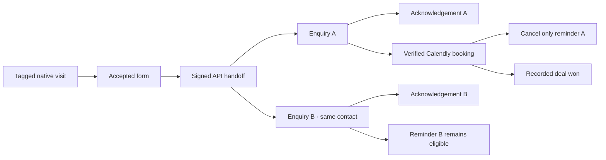
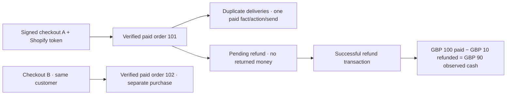

# Funnel release evidence — issue #42

Checked 17 October 2026. This evidence uses isolated migrated SQLite databases, production public service/API seams, the selected Calendly/Shopify verification adapters and the production Resend adapter with an explicitly injected TEST transport. No live account, real inbox or production provider network was used. The fake clock starts on Monday 19 October 2026 at 10:00 UTC so the published weekday send window is exercised deterministically.

## Completed integrated proofs

[The release proof tests](../../tests/integration/funnel-release-proof.test.ts) create their business records through actual accepted requests and service commands. They never insert contact bindings, subject references, journeys, transitions, financial facts, membership reasons or send results directly into the database. Database reads assert the resulting evidence. Every fixture gets a fresh migrated database and is removed afterward.



The sales proof asserts:

- A real native visitor/form HTTP sequence links a tagged visit to the accepted enquiry. Earlier anonymous evidence is replayed for measurement only.
- A signed API handoff reuses that enquiry/contact, binds the CRM identity and creates a second independent enquiry for the same person. Consent is recorded through the audited policy endpoint before nurture enrolment.
- A published SUBJECT campaign accepts two acknowledgements through separate durable memberships and retains two delayed reminder executions.
- A correctly signed user-scoped Calendly payload with the issued opaque correlation and matching recipient moves only enquiry A to Meeting. A's pending reminder is cancelled; B's due time remains unchanged.
- A signed `deal.won` moves A to Won with GBP 2,500 recorded value. B's reminder subsequently submits once. The three message sends have one accepted delivery attempt each and known provider IDs. Acceptance alone leaves delivery state unknown; this proof does not claim inbox delivery.
- The report has two journey cycles, one goal (50%), two enquiries ever reached but one still at Enquiry. The GBP 2,500 is SERVER_ASSERTED recorded won value, separate from paid cash. Captured campaign references are observable; no revenue credit is assigned. The report/history omit signing keys, provider secrets and the booking correlation token.



The commerce proof asserts:

- An authenticated checkout references the actual fixture Shopify checkout token. Its campaign tags are server-asserted observations. No anonymous browser visit is fabricated or silently joined.
- The raw-body HMAC-verified paid-order payload matches that checkout and binds the verified Shopify customer identity to the existing contact.
- The same delivery and another delivery of the same order retain one canonical paid fact, one Paid transition, one stage action and one send identity.
- A second checkout/order for the same API and Shopify customer identity creates another purchase subject, paid fact, membership and accepted send; the contact remains shared.
- A pending refund transaction creates no successful refund money. The later successful transaction and its repeated delivery retain one refund fact and both original paid facts.
- Reporting shows two goals, two purchases ever reaching Paid, one currently Paid and one Refunded. Exact GBP totals are 100 paid, 10 refunded and 90 net observed cash, with provider-verified money provenance. Campaign tags receive no causal revenue credit.

## Handoff security and evidence chain

[Ten focused handoff tests](../../tests/integration/funnel-handoff.test.ts) cover authentication before target validation; foreign owner/environment/inactive/unsupported targets; forbidden caller-controlled source/generation fields; accepted-generation preservation across retries and replay; identity/recipient conflicts on an existing subject; pending receipt and later identity/reference deletion fences; monetary conflicts before alias writes; identical reference deduplication; and manual-match order/financial isolation.

The evidence chain remains inspectable through source diagnostics, journey history and campaign membership/send history. Generated internal IDs are unique per test run; business fixture keys make the joins reproducible:

| Evidence | Durable link asserted or exercised |
| --- | --- |
| Native `form-a`, API `crm-a`/`crm-b` | `TrackingEvent.id` → source-qualified `FunnelSubjectReference` → distinct subject IDs and one contact |
| API handoff | Event audit `API_HANDOFF_REFERENCE`; target source/generation retained in the normalized reference; `IDENTITY_BOUND` audit |
| Booking invitee `maya-a` | Verified receipt → original enquiry A → immutable-version stage transition/history |
| Stage entry and exit | Journey/transition → action outbox/execution → campaign membership and independent membership reasons |
| Acknowledgement/reminder | Membership/revision/step → step execution → one message-send ID → accepted attempt → provider email ID |
| Orders `101`/`102`, refund `301`, transaction `401` | Source-qualified provider business keys → separate purchase subjects → canonical paid/refund facts → version/cohort report |

A provider namespace is not verification provenance. The handoff is an authenticated association asserted by the business server; Calendly/Shopify events retain provider verification separately. Manual matching cannot relocate a provider order or duplicate canonical money across subjects.

## Validation completed for this slice

With Node 24.16, run from the repository root:

```sh
node --import tsx --test \
  tests/integration/funnel-handoff.test.ts \
  tests/integration/funnel-release-proof.test.ts \
  tests/integration/funnel-tracking.test.ts \
  tests/integration/funnel-provider-contracts.test.ts
npx tsc --noEmit --project apps/web/tsconfig.json
```

Result: **47 tests passed, zero failed; application typecheck passed.** The two integrated chains are included in that count. The coordinated production browser run also passed **36/36 tests across Chromium, Firefox and WebKit**, including actual reporting flows and signed Shopify fixture evidence. The PR's full regression and CI checks remain the broader release gate; these focused results do not substitute for those checks.

Existing substantive recovery coverage is retained:

| Risk | Regression evidence |
| --- | --- |
| Restart, concurrent claims, expired leases, bounded retries/readback | [email-leases.test.ts](../../tests/integration/email-leases.test.ts), [email-sender-refresh.test.ts](../../tests/integration/email-sender-refresh.test.ts) |
| Lost provider acceptance, callback before response, conflicting late acceptance, frozen idempotency request | [email-delivery.test.ts](../../tests/integration/email-delivery.test.ts) |
| Booking backlog, pause, cancellation, scope-specific reasons, unsubscribe, queued negative evidence | [funnel-automation.test.ts](../../tests/integration/funnel-automation.test.ts) |
| Send windows, DST gaps/repeats, precise duration/date/event waits and timeout races | [email-timing.test.ts](../../tests/integration/email-timing.test.ts), [campaign-steps.test.ts](../../tests/integration/campaign-steps.test.ts), [campaign-waits.test.ts](../../tests/integration/campaign-waits.test.ts) |
| Late/duplicate/ambiguous input, source rotation, contact deletion, retention, real HMAC verification | [funnel-tracking.test.ts](../../tests/integration/funnel-tracking.test.ts), [funnel-provider-contracts.test.ts](../../tests/integration/funnel-provider-contracts.test.ts) |
| Cohort/version isolation, subject deduplication, exact currency-separated facts, attribution limits | [funnel-reporting.test.ts](../../tests/integration/funnel-reporting.test.ts) |

## Live pilot remains pending

The fixture result proves the implemented protocol and local state behavior under controlled inputs. It does not establish actual account entitlement, webhook subscription configuration, provider delivery timing, DNS readiness, mailbox delivery or production throughput. Those checks were not performed for the merged #42 controlled proof. The user subsequently supplied authorized pilot account/recipient details privately and selected a local Fluxsoft subscription pilot; this is configuration authority, not completed live evidence.

Before a live release, record an authorized small pilot using the [tracking setup](tracking-setup.md) and [email setup](email-setup.md)/[automation runbook](automation-setup.md): a real Calendly booking with returned correlation and cancellation/reschedule evidence; an installed Shopify test/live configuration with correct scopes, paid-order/customer data and successful refund transaction; and a verified Resend sender/webhook with explicitly consented recipient, positive provider receipt evidence and unsubscribe confirmation. Keep TEST/LIVE isolation, source generations and dispatch controls intact. Record actual source/receipt/journey/send IDs and safe diagnostics, never credentials or raw personal payloads. Absence of a callback is unresolved evidence, not proof of delivery or nonacceptance.

## Fluxsoft subscription pilot follow-up

[Issue #50](https://github.com/yohannesHL/marketing-app/issues/50) replaces Shopify with Fluxsoft subscriptions as the selected real commerce pilot while retaining the automated ecommerce coverage above. The [subscription bridge contract](subscription-bridge.md) defines the receiving API, explicit subscription identity, activation-only template and safe existing-subscriber import. A real Fluxsoft export consumer, reachable ingress and sanitized event-to-transition evidence are still required. LaunchPad receiver tests and a local server do not prove this external integration or mailbox delivery.
