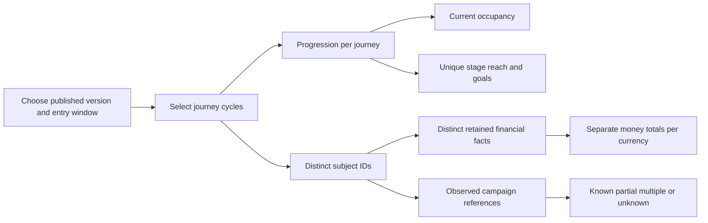
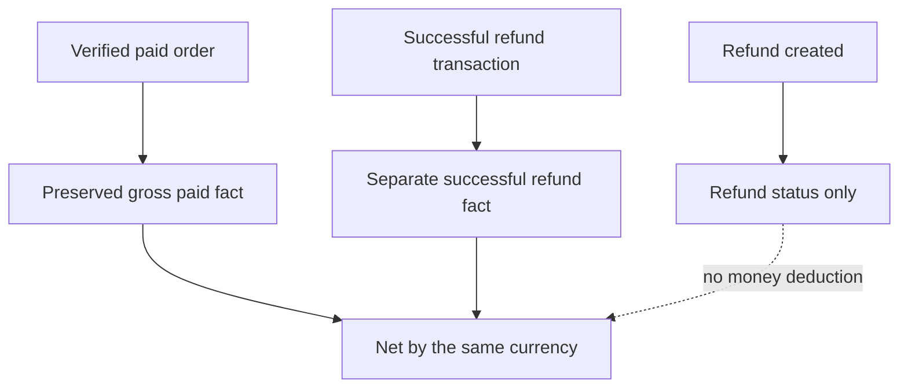

# Funnel results and operating guide

Results describe recorded evidence for one published funnel version and one entry cohort. They do not infer missing visits, provider delivery, marketing causation or future sales. TEST and LIVE are separate datasets.

## Reporting glossary

| Term | Definition |
| --- | --- |
| Subject | The business object a funnel tracks: a person, one enquiry, or one checkout/order. Two enquiries/orders for the same contact are two subjects. |
| Journey | One explicit cycle of one subject in one funnel. A new cycle counts again as a journey, but financial facts are deduplicated across selected cycles. |
| Published version | The immutable rules retained by those journeys. Reused stage names/IDs across versions are not silently combined. |
| Entry cohort | Journeys with recorded `startedAt` in the UTC half-open interval `[from, to)`. Exactly `from` is included; exactly `to` is excluded. |
| Observation time | The current database snapshot, `asOf`. Outcomes after cohort close can be included. This is not a reconstruction of a historical report. |
| Entry policy | Open entry at any configured entry stage, with entry counts shown by stage. Later-stage entrants are not silently excluded to improve conversion rates. |
| Current occupancy | Journeys whose current stage is this stage, including finished journeys. Active occupancy is shown separately. |
| Ever reached | Unique cohort journeys with recorded entry into this stage. Revisiting a stage does not increase its unique reach. |
| Visit | One residence in a stage. Manual revisits can create more visits than unique journeys. A cancellation audit is not another visit. |
| Goal conversion | A journey that reached any configured goal at least once, divided by all cohort journeys. A goal may remain open for later refund or follow-up stages. |
| Active/pending | A journey that remains ACTIVE. It is not assumed abandoned. |
| Known exit | A recorded unsuccessful terminal stage or explicit cancellation, shown separately. No elapsed-time threshold invents a drop-off. |
| Branch progression | Unique journeys with an automatic move on that rule/edge divided by unique journeys ever reaching its source stage. Entry routes use all cohort journeys. This is not probability among condition-eligible records. |
| Manual movement | An audited correction/entry, presented separately from automatic routing. |
| Time in stage | Operational residence from recorded transition times. Completed residence and censored current age are separate. Event occurrence times remain inspectable in history. |
| Time to goal | Recorded first-goal time minus recorded journey start. Missing/invalid intervals remain unknown. |
| Financial outcome window | Facts occurring from cohort `from` through current `asOf`, for distinct subjects in the selected cohort. This differs from the journey entry window. |
| Coverage | What retained, matched evidence is available, including imports, redaction, unknown attribution and incomplete monetary values. Absence of evidence is not proof of no activity. |



## Read a conversion result

If one enquiry entered Lead and later reached Booked, Lead has one ever-reached journey and zero current occupants. Booked has one current occupant. If Booked is an open goal, that journey can simultaneously be converted and ACTIVE. A later cancellation or refund does not erase the earlier goal reach.

An independently entered second enquiry for the same person increases the journey and subject counts. An explicit new cycle for the original enquiry increases journeys but not distinct subjects. An old paid fact attached to that subject is not counted twice within the report.

The branch denominator is visible with each numerator. Routes with missing conditions wait according to their saved rules; reporting does not infer that every reached journey was eligible for every branch. Parallel observed edges and manual corrections may make rows non-additive. A rule whose trace cannot distinguish same-destination branches is reported at the supported rule/edge level rather than assigned a fictional branch.

## Financial outcomes

| Measure | Evidence | Meaning |
| --- | --- | --- |
| Potential pipeline | No opportunity-value model in this release | Unavailable; do not derive from stage labels or goals. |
| Recorded won-deal value | Unique `deal.won` fact | Recorded sale value, distinct from money received. Its source authority remains visible. |
| Gross paid | Unique `order.paid` fact | Observed payment amount with explicit currency. |
| Successful refunds | Unique `refund.succeeded` fact | Observed successful money-return transaction. A refund request/record alone is insufficient. |
| Observed net | Gross paid minus successful refunds in the same currency | Can be negative with incomplete or selected-window payment coverage. |

Money remains precise decimal strings. There is no currency conversion and no combined mixed-currency total. Original paid facts survive refunds. Unknown amount/currency remains unvalued, never zero. Provider verification and a customer's authenticated server assertion remain distinct provenance.



The selected financial window can exclude a payment that occurred before the cohort began even if its delayed arrival created a journey during the cohort. Narrowing an entry window changes the subject set, while the observation window still includes later outcomes. Overlapping cohort/version reports are not additive financial ledgers. Use the source records to reconcile accounting totals.

Average order value or cost per result must not appear without a stated eligible denominator, value/spend source and coverage. Forecasts are outside measured outcomes in this release.

## Campaign results and attribution

Campaign links describe configuration; they do not prove that a campaign caused conversion. Results keep observed campaign references separate from associated stages and email execution evidence.

Attribution uses retained, MATCHED observations explicitly attached to selected subjects. Captured `campaign`, `utm_source`, `utm_medium` and `utm_campaign` values can be reported. Unknown stays unknown after absent capture, blocked tracking, cross-device gaps or payload erasure. Partial tags remain partial; multiple observed references do not become a guessed first/last-touch model. No revenue credit is allocated. Calendly's opaque `utm_content` correlation token is not a marketing tag.

Email results use actual persisted membership reasons and send-attribution records. A shared CONTACT membership is not proof that every message belongs to every associated enquiry. Results retain the actual pinned campaign revision, including when a later association requested a newer version but reused the existing membership. Provider acceptance, confirmed delivery and unknown delivery remain separate states. Never add fan-out campaign rows to claim a unique global conversion/send total.

Aggregate ad impressions, clicks and spend remain separate advertising results. They cannot identify an individual subject, fill attribution gaps or move a journey.

## Working views

Results, campaign results, People/journeys and the stage board serve different tasks. The board uses the selected published version and entry cohort; total stage counts and loaded cards are labelled separately. Inspect a card for its exact evidence and use a reasoned manual correction when necessary.

Sales management in this release is a board of independent sales enquiries with existing contact summaries and audited journey history. Opportunity values, private sales notes, follow-up tasks, forecasting, and a full CRM are not silently inferred from funnel stages. Potential pipeline remains unavailable until an explicit opportunity model is implemented.

## Report and board APIs

The owned session-authenticated endpoint is `GET /api/funnels/:id/reports?versionId=:versionId&from=:from&to=:to`. `from` and `to` are required explicit-offset ISO instants. Omit `versionId` to select the current published version. Both the funnel and requested version must belong to the signed-in customer and environment; a draft has no report. Unknown or duplicate query keys are rejected. A historical `asOf` parameter is not supported.

```ts
// Run inside the signed-in LaunchPad client. These reads have no campaign effects.
const query = new URLSearchParams({
  versionId: selectedPublishedVersionId,
  from: "2026-10-01T00:00:00.000Z",
  to: "2026-10-15T00:00:00.000Z",
});
const response = await fetch(`/api/funnels/${funnelId}/reports?${query}`, {
  credentials: "same-origin", cache: "no-store",
});
if (!response.ok) throw await response.json();
const report = await response.json();
// report.schemaVersion === 1; monetary amounts are decimal strings.
// report.cohort.asOf is captured by the server in its read transaction.
```

The aggregate response contains no contact summary, recipient address, raw webhook, message body or signing secret. Approved observed campaign tags are included as supplied; customers should avoid personal information in their marketing tags. Source/campaign names are current display metadata, while version stage labels are immutable historical configuration.

The stage board uses the separately owned `GET /api/funnels/:id/journeys` endpoint with the same version and entry window. Each response includes `journeys`, the full matching `total`, and an opaque `nextCursor` (or `null`). Send that cursor with the unchanged filters for the next page. Pages contain at most 50 records and include an owned contact summary per business subject. This is current operational data fetched independently of the aggregate transaction; concurrent movement can change cards between pages. The UI labels loaded cards separately from full report counts and offers a refresh.

`INVALID_REPORT_RANGE` rejects invalid, reversed or future windows. `FUNNEL_UNPUBLISHED` requires publication first. `NOT_FOUND` does not reveal another customer's funnel/version. `REPORT_LIMIT_EXCEEDED` returns HTTP 422 instead of partial totals: narrow the entry interval. Production bounds are 5,000 cycles, 25,000 transitions, 20,000 financial facts, 10,000 matched/redacted observations, 25,000 records per campaign association query, and a 16 MiB budget for projected definition/transition/fact/observation JSON. Projection extracts only approved fields before loading into the application. The report uses a single current read transaction and does not invoke workers or providers.

The workspace lists recent published versions; journey history provides **Results for this version** for an older pinned version. Filtering changes only the report, not the draft, contacts, running journeys, or automation controls.

## Explicit source handoffs

An authenticated customer server can name a business reference in another owned source to join its observations to the same business object. This association is explicit and authenticated; an email-address match is insufficient.

```mermaid
sequenceDiagram
    participant Site as Customer website/server
    participant API as Signed event ingress
    participant Match as Owned reference matching
    participant Shop as Shopify webhook
    participant Funnel as Purchase journey
    Site->>API: Checkout observation + qualified Shopify checkout reference
    API->>Match: Verify signature, ownership, environment and source generations
    Match->>Funnel: Create/match checkout subject; record API assertion
    Shop->>API: Signed paid order with checkout token
    API->>Match: Verify provider evidence and business references
    Match->>Funnel: Preserve same subject; record verified payment
    Note over Funnel: Browser/server observation is not payment proof
```

Native accepted forms do not silently merge contacts by email. A later signed server handoff can explicitly bind a stable external contact identity to the existing enquiry's contact. Conflicting identities require review; handoffs do not overwrite recipient data. A new enquiry/order keeps its own subject even when that stable identity identifies the same contact.

Configure these integrations on the customer server. Never expose a signing secret in browser JavaScript. Inspect the source event and binding audit to distinguish an API-established reference from later provider verification. Source rotation, deletion tombstones and conflicting references block stale or ambiguous handoffs. Historical replay cannot grant old evidence new sending authority.

## Monitoring and support

1. Check the environment, published version, entry window and observation time before comparing reports.
2. Inspect source readiness separately from receiving/matching. An idle source may be healthy. Unsupported source types require an adapter; arbitrary provider totals cannot substitute for individual evidence.
3. Inspect the exact source receipt, normalized authority, match status and business references. Keep ambiguous evidence unmatched. Repair through explicit audited matching; history-only recovery does not send retrospective messages.
4. Inspect the pinned journey transition, rule and reason before editing a draft. Publication affects future qualifying entries; it does not migrate existing runs.
5. For automation, inspect the action, membership reason, wait deadline and send attempt. Separate enrollment and dispatch controls. Recheck consent, suppression, current source generation and sender readiness.
6. For unknown provider acceptance, reconcile the existing intent. Do not create another message to escape uncertainty. Accepted external work cannot be recalled by a local cancellation.
7. Reconcile paid/refund facts against the source order and transaction IDs, with exact currency. Preserve original payment history. Explain gaps before interpreting negative net or missing attribution.
8. If a report exceeds its explicit record limits, narrow the cohort; the API rejects the whole report rather than return truncated totals.
9. Use the tracking, funnel, automation and email worker procedures in the linked setup guides. Review retention/deletion effects and access scope before exporting support evidence; do not export credentials or message bodies.

See [tracking setup](tracking-setup.md), [email setup](email-setup.md), [automation operations](automation-setup.md), [builder guide](builder-guide.md), and [release evidence](release-evidence.md). Fixture protocol and browser checks are evidence of local behavior. Actual provider installation and authorized live recipients remain separate release checks.
