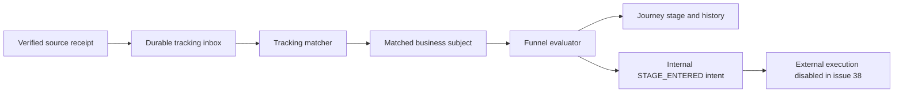
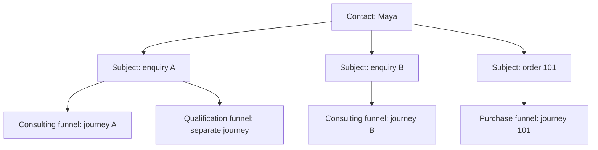

# Custom funnel definitions and evaluation

Issue #38 adds custom funnel definitions, publication, deterministic stage evaluation, journey history, audited manual movement and a no-send simulator. It builds on [tracking sources](tracking-setup.md) and follows [contracts v1](contracts.md). Funnel stages are user-defined configuration: sales, purchases, events or subscriptions do not require separate engines or hard-coded stage names.

This slice records internal `STAGE_ENTERED` intents transactionally. External effects are disabled: it does not send an email, enrol a provider sequence, launch an ad or publish a social post. Campaign delivery and automation execution are separate subsequent issues. Stage tracking remains useful while those features are disabled.

## Run the two processing steps

The tracking matcher first connects accepted source receipts to an owned, environment-scoped business subject. The funnel evaluator then evaluates that subject's evidence against published rules and records journey state, transition history and local intent records together.



Use Node 24.16 or a later Node 24 release and apply the repository's forward-only migrations. Web, matcher and evaluator must share the same persistent database. Configure an explicit absolute local SQLite URL such as `file:/srv/launchpad/data/launchpad.db`, or a persistent remote URL supported by the existing client. The evaluator refuses missing, relative local or in-memory database configuration. Absolute `file:` and `file://` paths are accepted. It also needs the same `APP_ORIGIN` as the web app; it does not require provider credentials or the credential vault.

Run one matching operation followed by one evaluation operation for operator diagnosis:

```sh
npm run tracking:worker -- run-once
npm run funnels:worker -- run-once
```

Run both long-lived workers under the deployment's supervisor for normal processing:

```sh
npm run tracking:worker -- run
npm run funnels:worker -- run
```

These are separate processes; starting the evaluator does not start the matcher. An idle evaluator waits one second between polls. SIGINT/SIGTERM stops new work, allows the current transaction to finish and disconnects the database. Logs contain only status/error codes, never event payloads, contact information or exception messages. Database rows are the work queue; there is no web-request timer or process-local event queue.

## Management API

All requests require the LaunchPad customer session. Mutations require an exact `Origin` matching `APP_ORIGIN`. JSON bodies are limited to 128 KiB. Responses are private/no-store and cross-owner records are unavailable. Definitions and sources retain TEST/LIVE isolation.

| Method and endpoint | Body or query | Operation |
| --- | --- | --- |
| `GET /api/funnels` | Required `environment=TEST` or `environment=LIVE` | List owned funnels in the selected environment |
| `POST /api/funnels` | `name`, `environment`, `subjectKind`, `definition` | Create a custom draft |
| `GET /api/funnels/:id` | None | Read the owned funnel and its definition state |
| `PATCH /api/funnels/:id` | `draftRevision`, optional `name`, `definition` | Replace the draft using its expected revision |
| `POST /api/funnels/:id/publish` | `draftRevision` | Publish the reviewed draft as an immutable version |
| `PATCH /api/funnels/:id/status` | `status` | Change the funnel's lifecycle status |
| `GET /api/funnels/:id/journeys` | Optional `cursor` | Read paginated business-object journeys |
| `GET /api/funnels/:id/journeys/:journeyId/history` | None | Read that journey's explanations and transition history |
| `POST /api/funnels/:id/move` | `subjectId`, `stageId`, `reason`, `commandKey`, optional `newCycle` | Record an audited manual movement or explicit new cycle |
| `POST /api/funnels/:id/simulate` | Optional `definition`, optional `currentStage`, `events` | Evaluate sample evidence without provider calls or persisted live changes |

The simulator's event samples contain `sourceId`, `type`, `properties` and `occurredAt`, with at most 100 samples per request. Call it with a candidate `definition` to inspect draft changes before publication, or omit that field to use the funnel's current draft. Simulator results describe decisions; they do not assert that the supplied sample came from a real source. The simulator also does not prove source ownership, publication timing, identity matching or consent readiness; it reports these as separate checks.

Funnel statuses are `ACTIVE`, `PAUSED` and `ARCHIVED`. Pausing or archiving stops new automatic entry; existing active journeys continue evaluating evidence on their pinned version. Neither status silently erases history or recalls prior activity. Manual tracking corrections remain explicit owner actions. Source pausing/disconnection is a separate tracking control.

## Definition format

The schema-version-1 definition contains `stages`, `entryStages` and ordered `routes`. Each stage has an opaque definition-local `id`, a user-defined `name`, a `goal` boolean and a `terminal` value of `NONE`, `SUCCESS` or `FAILURE`. Routes have their own `id`, a `from` stage (`null` for entry), one trigger, ordered branches and an explicit fallback. Each branch has an `id`, destination `to` and optional `when` condition; omitting `when` is an unconditional branch.

This consulting example is ordinary configuration. Replace the CRM and Calendly source placeholders with connected source IDs from the same owner and environment whose allowed event types include the specified triggers. The server API creates the enquiry and later reports the agreement using that same source-qualified business reference; the Calendly booking uses verified correlation to that enquiry. Matching an email address alone does not connect events from different sources. Create a SALES funnel with this definition; names and routing can be edited for a different business process.

```json
{
  "schemaVersion": 1,
  "stages": [
    { "id": "received", "name": "Enquiry received", "goal": false, "terminal": "NONE" },
    { "id": "call", "name": "Discovery call booked", "goal": false, "terminal": "NONE" },
    { "id": "signed", "name": "Agreement signed", "goal": true, "terminal": "SUCCESS" }
  ],
  "entryStages": ["received"],
  "routes": [
    {
      "id": "new-enquiry",
      "from": null,
      "trigger": { "kind": "EVENT", "sourceId": "CRM_SOURCE_ID", "type": "enquiry.accepted" },
      "branches": [{ "id": "accept", "to": "received" }],
      "fallback": { "kind": "WAIT" }
    },
    {
      "id": "booked-call",
      "from": "received",
      "trigger": { "kind": "EVENT", "sourceId": "CALENDLY_SOURCE_ID", "type": "booking.confirmed" },
      "branches": [{ "id": "booked", "to": "call" }],
      "fallback": { "kind": "WAIT" }
    },
    {
      "id": "won-agreement",
      "from": "call",
      "trigger": { "kind": "EVENT", "sourceId": "CRM_SOURCE_ID", "type": "deal.won" },
      "branches": [{ "id": "won", "to": "signed" }],
      "fallback": { "kind": "WAIT" }
    }
  ]
}
```

Trigger kinds are `EVENT` and `PROPERTY_CHANGE`. Both specify `sourceId` and event `type`; `PROPERTY_CHANGE` additionally names the changed `key`. Conditions can combine `{ "all": [...] }` and `{ "any": [...] }` groups. A leaf selects either an incoming event property with `field: {scope:"EVENT", key}` or a retained source-qualified property with `field: {scope:"PROPERTY", sourceId, type, key}`. It declares `type` (`string`, `boolean`, `number`, `decimal` or `datetime`) and `op` (`eq`, `neq`, `gt`, `gte`, `lt`, `lte`, `in`, `isKnown`, `isMissing` or `isNull`). Comparisons supply `value`; `in` supplies 1–100 values, while existence/null operators omit the value. Ordered comparisons support number, decimal and datetime fields. Decimal strings use plain signed decimal notation and exact comparison; datetime strings require an explicit timezone. Types and compatible operators are validated before use.

For example, a branch condition can require both a known tier and a decimal minimum amount from the triggering event:

```json
{
  "all": [
    { "field": { "scope": "EVENT", "key": "tier" }, "type": "string", "op": "eq", "value": "business" },
    { "field": { "scope": "EVENT", "key": "amount" }, "type": "decimal", "op": "gte", "value": "100.00" }
  ]
}
```

The source must actually produce the configured properties. Use decimal strings for money comparisons and constrain currency explicitly when amounts may have different currencies. A field name in a rule does not create tracking instrumentation. Unsupported fields/operators, invalid typed values and graph cycles produce validation errors. Definitions allow up to 256 stages, 512 routes and 256 branches per route, with at most 256 total condition nodes and condition depth 8, within the 128 KiB body/definition limit; these are operational bounds rather than a fixed funnel layout. An empty definition may be saved as a draft; publication requires at least one stage and allowed entry stage. A manual-only definition needs no automatic entry route.

## Editable starter templates

`createFunnelTemplate(kind, bindings)` in `funnelTemplates.ts` returns a fresh ordinary definition. It does not publish, call a provider or create a separate runtime. Callers may rename stages, add qualification branches, remove optional steps or replace the entire graph before saving. The later builder consumes these definitions through the same draft APIs.

| Kind | Starting process | Required source capabilities |
| --- | --- | --- |
| `blank` | One manual-entry `Lead` stage | No source binding required until automatic rules are added |
| `sales` | Enquiry → optional booking → won/lost | Primary API source with `enquiry.accepted`, `deal.won`, `deal.lost`; optional Calendly `bookingSourceId` with `booking.confirmed` |
| `ecommerce` | Purchase goal → refund activity | Primary Shopify source with `order.paid` and verified `refund.succeeded` |
| `events` | Registered → attended → follow-up, or no-show | Primary API source with `custom.event.registered`, `custom.event.attended`, `custom.event.followed_up`, `custom.event.missed` |
| `subscription` | Trial → setup → key feature → subscribed → cancellation | Primary API source with `custom.trial.started`, `custom.trial.setup`, `custom.trial.feature_used`, `custom.subscription.started`, `custom.subscription.cancelled` |

Nonblank templates require a nonempty `primarySourceId`; sales optionally accepts `bookingSourceId`. These bindings are actual connected-source IDs, not provider names. Template creation validates the definition's structure, while publication verifies that each source exists, is active, belongs to the owner/environment and permits every referenced event/property. A placeholder source ID cannot pass those publication checks. Set the funnel's `subjectKind` consistently with the subjects produced by the instrumented source.

A NATIVE form source permits accepted enquiries and browser observations; it cannot assert `deal.won`, `deal.lost` or `custom.*` events. For a native-only process, start from blank and add its configured enquiry entry rule, then use audited manual changes for later stages, or instrument a server API process with stable business references. Do not bind the complete sales template to a native source and assume its later stages can be measured.

The ecommerce purchase stage is a goal with `terminal: "NONE"`, so a later verified refund can be observed. The refund stage is also nonterminal: a successful partial refund does not prove the whole order failed. Define explicit terminal criteria for the business's return/refund policy. These defaults preserve evidence without inventing financial outcomes.

## Publication and business-object boundaries

Draft updates require the revision the editor read. If another editor has changed the draft, refresh and reconcile those edits before publishing; do not retry by silently overwriting the current revision. Publishing creates an immutable version. New journeys use the published version eligible for their new evidence. Existing journeys remain pinned to the version they started with, so changing a draft or publishing a new version does not rewrite their stages or interpretation of history.

Publication is future-only. It does not enrol every historical contact whose old properties happen to match, replay past event occurrences as new triggers, or activate past campaign actions. Existing-run migration is not implicit. Backfill/replay and manual corrections preserve their measurement-only provenance; the later automation executor must not turn them into sends.

A contact is a person; a subject is an enquiry, purchase or other business object; a journey is one subject's run through one funnel/version. Two enquiries from Maya and two purchases by Maya remain independent subjects. The same subject may participate in different funnels independently. There is one current stage in each journey and no duplicate active run for the same funnel/subject. Re-entry after a completed run requires an explicit new cycle rather than another delivery of the original event.



## Rule timing and explanations

An event condition asks whether a specific incoming occurrence matches. A property condition asks whether the available subject property snapshot satisfies a predicate at evaluation time. They are distinct concepts: repeatedly reading an old property does not manufacture another event occurrence. Property snapshots are qualified by source, event type and key; a `PROPERTY_CHANGE` trigger requires an actual change to that qualified field. Newer resource-version evidence replaces older values, while different values claiming the same version produce UNKNOWN conflict evidence. A property absent from the snapshot is UNKNOWN for ordinary comparisons, rather than implicitly false or an empty string; `isMissing` is the explicit test for absence.

Routes and their outgoing branches have a published order. Only the first trigger-eligible route is evaluated. Its first matching branch is selected exclusively; one incoming cause can produce at most one transition, so a single event cannot cascade through multiple stages. An earlier UNKNOWN branch blocks lower-priority branches and the fallback: missing or conflicting evidence must not silently become a negative result. When every branch is definitively false, `fallback: {kind:"WAIT"}` leaves the stage unchanged or `fallback: {kind:"MOVE", to:"stage-id"}` selects an explicit destination. A fallback never runs for an unrelated event. The evaluation trace records the result used for each considered rule.

Goals and terminal stages have different meanings. A goal marks a business milestone used for measurement. A terminal stage finishes a journey. A successful goal need not be terminal when later refund, cancellation or follow-up evidence should still have an explicit path; an unsuccessful terminal exit need not be a goal. Name outcomes for the user's actual process rather than assuming every finish is a purchase.

Automatic graphs are bounded directed acyclic graphs in this release. Cycles and unsupported definitions are rejected with validation errors before publication. Configure explicit forward correction/refund stages where needed. Late checkout observations do not implicitly move a purchased journey backwards. Manual movement is the explicit, audited mechanism for a deliberate correction or return.

## Manual movement and recovery

Manual commands select an owned subject, a stage from the applicable version and a reason. Keep `commandKey` stable when retrying the same command; a network retry is not a new business decision. A new intentional command needs its own key. Manual moves are tracking-only by default and retain the actor, reason, old/new stage and version in history. They do not send campaigns.

Use `newCycle: true` only to intentionally start another eligible run after the previous run has ended. Reusing the original event or double-clicking a command must not create two active journeys. Sources, contacts, subjects, funnels and versions must belong to the same owner/environment at the applicable boundaries; manually selecting an ID does not bypass those rules.

The evaluator writes journey changes, their history and internal intent identities in one transaction. A process crash cannot leave a stage transition committed without its corresponding local intent, and duplicate/concurrent processing must not create duplicate local intents. This is a local transaction guarantee; it is not a promise of exactly-once delivery to external providers.

Inspect history to explain a result using its pinned version, source event or manual actor, evaluated rule, old/new stage and processing time. Diagnose missing source or identity evidence in tracking diagnostics first. Fixture tests demonstrate deterministic rules, isolation and recovery behavior; they do not establish a real provider connection or authorize external actions. Integrated live evidence and reporting remain part of the later acceptance work.

## Evidence admission and recovery boundaries

Canonical payment evidence is consumed once as an event occurrence. A later verified observation of that same payment may carry a genuine property change; it can evaluate a property-change rule without reusing the paid-event trigger. Unchanged duplicates do neither. A current credential generation can corroborate an unchanged provider resource without inventing a property change. Missing evidence from a disconnected source is unavailable, not an eligible `isMissing` match.

An accepted native form durably queues earlier anonymous observations for history-only identity repair. The matcher handles each observation in a separate transaction and atomically creates its evaluation receipt, so a large visit history cannot turn form acceptance into an unbounded series of writes. Retention preserves pending evaluator evidence and active-journey evidence; eligible matched payloads can be redacted after 180 days while identity/digest/effect tombstones remain. Future wait/job consumers must participate in this retention boundary.

Simulator events accept optional `evidenceKey` and `resourceUpdatedAt`. Reuse the same evidence key for webhook/API copies of a canonical fact; omitting it means each sample represents a distinct occurrence. Resource version defaults to occurrence time when omitted. This lets sample runs reproduce canonical event deduplication and newer-property observations without contacting providers. Source readiness, publication admission and identity matching are separately enforced by the live service.
