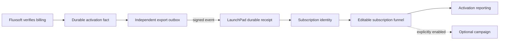
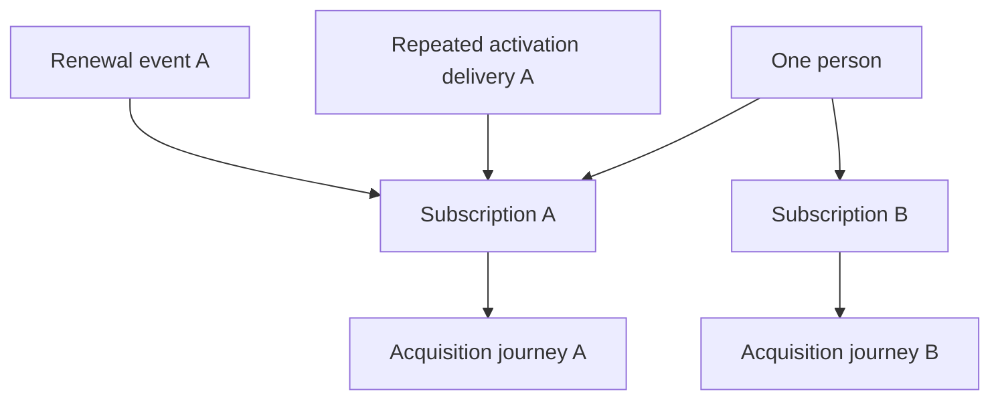
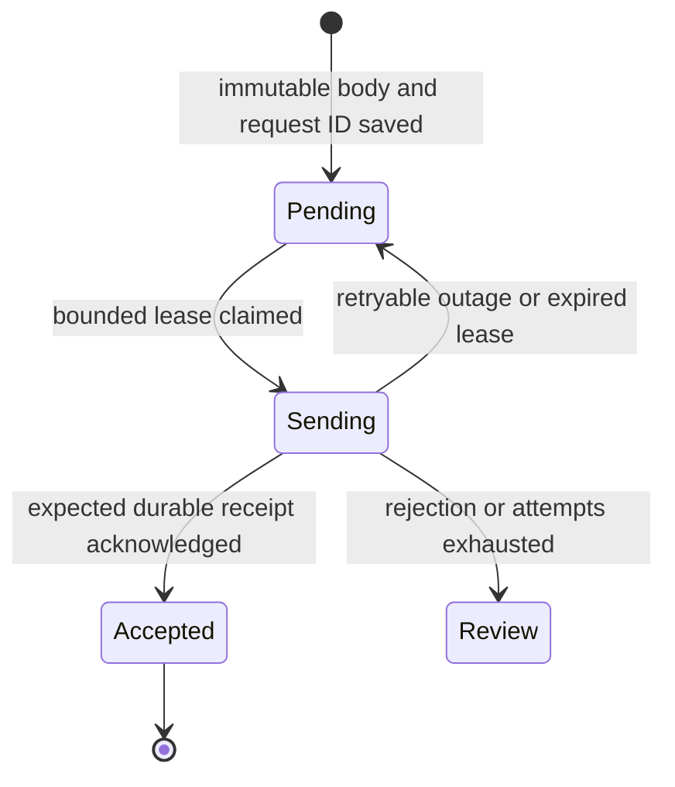

# Subscription tracking through backend events

LaunchPad accepts signed subscription events from a product backend. The backend keeps its billing integration and decides which business facts it can assert. The public marketing site needs no billing credentials. This contract is the LaunchPad receiver portion of [issue #50](https://github.com/yohannesHL/marketing-app/issues/50); a durable Fluxsoft export consumer and real provider evidence are separate rollout requirements.



Fluxsoft already records a verified `subscription-active` lifecycle event. It does not yet export that event to LaunchPad. Its current activation output does not establish an invoice ledger, renewal revenue, payment failure, cancellation or refund. The bridge authenticates the producing application, so evidence in LaunchPad is **SERVER_ASSERTED**, not a direct Stripe verification.

## What is a subscriber?

Choose the business object being measured. A newsletter signup is normally a contact; a paid subscription is a `SUBSCRIPTION` subject. A person can own several subscriptions, each with a separate funnel journey. A subscription can also be tracked without a known contact.



Use a stable subscription ID as the primary resource. Customer/workspace/account identifiers are context, not aliases that join subscriptions. A contact identity must identify an actual person; do not select an arbitrary workspace admin. No email is inferred from a Stripe customer or from the browser session. Receiving an event does not grant marketing consent.

Within each source namespace, a subject may have only one subscription ID. Authenticated [cross-source handoff](tracking-setup.md#authenticated-handoff-between-sources) can explicitly associate the same subscription with another owned API source. Environment, source generation, contact conflict and deletion fences apply. Keep the same source for the same producer/account/mode; creating replacement sources unnecessarily breaks its identity namespace.

## Configure the source and funnel

1. Apply migrations. Start the web app and tracking/funnel workers against the same database and keyring, following [tracking setup](tracking-setup.md).
2. Create a **Server API** tracking source in TEST. Use a stable producer/account/mode label, such as `fluxsoft:account-example:test`. Configure only `custom.fluxsoft.subscription_active` initially and only required scalar property keys, such as `workspaceId`. Keep its generated signing secret on the product backend.
3. Create a funnel with the direct **subscription activation** template and select that source. Its goal is reached by the activation event. The separate **subscription trial** template requires real trial/setup/usage observations; it is not suitable for a product that does not emit them.
4. Review and publish the definition. Leave campaign actions empty to measure subscriptions without sending email.
5. Send a signed event, inspect its receipt, and run the tracking/funnel workers. A durable receipt is only the first step; verify that it matched the intended subject and produced the expected transition.

An API source creation body is:

```json
{
  "name": "Fluxsoft subscriptions",
  "provider": "API",
  "environment": "TEST",
  "externalAccountId": "fluxsoft:account-example:test",
  "config": {
    "allowedEvents": ["custom.fluxsoft.subscription_active"],
    "propertyKeys": ["workspaceId"]
  }
}
```

Source management requires an authenticated LaunchPad customer session and exact Origin. Never place its signing secret in browser code, a public issue, analytics properties or a repository fixture.

## Event body and signature

```json
{
  "schemaVersion": 1,
  "type": "custom.fluxsoft.subscription_active",
  "occurredAt": "2026-10-17T10:00:00.000Z",
  "resource": { "kind": "SUBSCRIPTION", "id": "sub_example" },
  "references": [],
  "subjectKind": "SUBSCRIPTION",
  "properties": { "workspaceId": "org_example" }
}
```

`occurredAt` is the time represented by the source fact. Fluxsoft's existing lifecycle timestamp records when activation was established, not necessarily the original invoice payment time. Do not relabel it as a payment timestamp or recreate it on retry. The optional `contactIdentity` and `contact` fields follow the existing server API contract; omit both until the producer can identify the intended person explicitly.

Persist the serialized body and delivery request ID before attempting network delivery. For Fluxsoft, derive the delivery ID from the existing lifecycle semantic key, which includes account, mode and subscription; a SHA-256 hex digest satisfies LaunchPad's request-ID format. It is different from the subscription resource ID. Repeated delivery of the same bytes returns the existing receipt. Reusing a delivery key with changed bytes is a conflict. LaunchPad also derives one canonical activation fact per matched subscription, preventing another delivery ID from creating another acquisition effect.

For a durable exporter, include `expectedSourceGeneration` with the positive integer generation returned during source setup. Pin it in the persisted body. LaunchPad rejects a mismatch with `409 TRACKING_SOURCE_GENERATION_MISMATCH` before accepting evidence, including stale duplicate deliveries. Pause/resume, configuration changes and credential rotation therefore require explicit exporter review; do not silently refresh a queued event to the new generation. Older API clients can omit the optional field.

Send the persisted bytes to `POST /api/tracking/ingest/:sourceId/events`. Each attempt signs `timestamp.requestId.exactBody` using HMAC-SHA256, with the three `X-LaunchPad-*` headers shown in [server API signing](tracking-setup.md#server-api-signing). Refresh only the timestamp and signature on retry. The signature freshness window is 180 seconds, the JSON body limit is 32 KiB, and request IDs are 8–128 letters, digits, hyphens or underscores. Do not follow redirects with credentials.

## Existing production subscribers

An existing subscriber is history, not a new acquisition email opportunity. Add this field to the persisted signed body when importing historical facts:

```json
{ "ingestionMode": "BACKFILL" }
```

This is an additional field on the complete event body, not a separate request. Omitting it uses normal live ingestion. `BACKFILL` is the only explicit value accepted: callers cannot request `LIVE` or `REPLAY`, assign evidence authority, or choose another account/environment. Source environment TEST/LIVE and event ingestion mode BACKFILL/LIVE are separate concepts; production history belongs to a LIVE source with BACKFILL processing.

BACKFILL imports the subject and evidence, but does not automatically start an acquisition journey. It can correct eligible existing journeys within their pinned publication/time rules; those effects remain history-only and cannot enroll or dispatch external campaign work. Replaying/importing an activation under another delivery ID does not turn it into a fresh acquisition. Body changes under the original key fail idempotency checks. Operators must not try to turn imports into live sends by creating duplicate sources or manually inventing new acquisition cycles.

The exporter needs an explicit cutover timestamp and must retain its chosen mode in the immutable outbox body. Existing backlog and unknown historical timing should be classified as BACKFILL. A slow or retried fresh event keeps its original classification. Imported subscribers are visible as tracked subjects and receipts, not automatically counted as new acquisitions in funnel results. Reconstructing historical acquisition cohorts is outside this release. Existing journey corrections retain the [reporting](reporting-guide.md) timestamp semantics, and the original event occurrence time remains available as evidence.

## Exporter responsibilities

The receiving API does not replace a durable sender. Fluxsoft needs an independent outbox consumer of eligible lifecycle records. Its mail delivery queue must remain separate.



The exporter must:

- Persist source/account/mode, semantic event key, immutable body/request ID, attempts, lease ownership/expiry, next attempt and safe error code. Bound each scan and retry loop.
- Keep network delivery outside billing transactions and checkout responses. A LaunchPad outage must not break subscription provisioning or Fluxsoft service emails.
- Disable export unless explicitly configured. Bind source/account/mode and cutover; never send test-mode billing records to a LIVE source. Resetting configuration must not silently retarget a queued record.
- Require HTTPS for external destinations, reject redirects, use bounded response size/timeouts, and avoid logging personal bodies or secrets. Local tests can use an explicitly controlled loopback fixture.
- Retry ambiguous network outcomes with the same body/request ID. Honor bounded backoff for transient failures. Authentication, configuration and idempotency conflicts need review rather than an endless hot retry.
- Acknowledge only the expected successful receipt response. Monitor accepted-but-unmatched/blocked LaunchPad receipts separately; a 202 is not proof of matching, transition or delivery.

These are producer requirements, not a claim that this repository implements Fluxsoft's export worker.

## Reporting and automation limits

Activation is one acquisition fact for one subscription. Renewals retain that subscription identity and do not automatically start a new acquisition cycle. The direct-activation template remains editable, but recurrent billing status should not be modeled as a cycle in the directed acyclic acquisition graph.

No amount or currency is required for activation. Money received, MRR, renewals, refunds and cancellation status remain unavailable until their explicit contracts and evidence exist. Empty financial results do not mean zero revenue. Do not reuse `order.paid` for a subscription or treat a plan's list price as paid cash.

Later events can describe `renewed`, `payment_failed`, `cancellation_requested` and `ended`, but each needs its own proof and idempotency. Stripe distinguishes subscription creation, updates and actual end; creation may still be incomplete. See [Stripe subscription webhook semantics](https://docs.stripe.com/billing/subscriptions/webhooks) and [delivery/signature behavior](https://docs.stripe.com/webhooks). These remain the product backend's responsibility.

Marketing campaigns require an explicit person/recipient association, current policy eligibility, compatible environment, ready sender, published campaign and enabled automation. The tracking-only activation template does none of those implicitly. Production subscribers must not be enrolled merely because they were imported.

## Evidence required before calling the integration live

The local pilot can validate this receiving contract with synthetic data, but production Fluxsoft cannot reach a loopback-only LaunchPad URL. Configure a deliberate reachable HTTPS endpoint/tunnel or deployment for real events. Do not move Stripe webhook ownership to LaunchPad to solve local connectivity.

Retain sanitized evidence for the provider receipt → Fluxsoft lifecycle record → export request/acknowledgement → LaunchPad receipt → subscription subject → funnel transition. Prove two subscriptions for one contact remain separate, duplicate deliveries yield one acquisition, imports cause no campaign sends, and deletion/disconnect fences survive retries. If testing email, separately record consent, membership, send attempt, provider callback and suppression evidence with an authorized recipient.

No real provider event, mailbox delivery or production import is implied by unit tests, simulation or a merged PR. Keep issue #50 and the live acceptance items in #37/#39/#42 open until the corresponding evidence exists.
