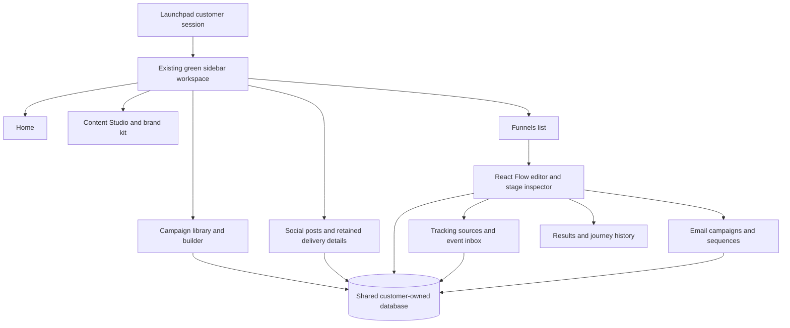

# Funnels in the existing Launchpad workspace

The application shell is `components/workspace/AppShell.tsx`: the green sidebar
with Home, Campaigns, Content Studio, Social marketing and Integrations / channels.
Funnels lives inside this same shell, session and database. The public product
landing page remains at `/`; the signed-in home is `/dashboard`.

## Navigation and editing

- **Funnels** appears after Campaigns in the desktop sidebar and in the mobile
  **More** menu. It opens `/funnels` and highlights throughout the editor and
  journey history routes.
- The funnel area links to tracking sources and email campaigns. Search quick
  actions also open all three. TEST/LIVE selection is preserved between them.
- Funnel, tracking and email editors register with the workspace navigation guard.
  Sidebar, mobile, quick-action and sign-out controls respect pending writes,
  unsaved edits and one-time source credentials. The existing campaign and social
  editors keep their original save/discard dialogs.
- Sign-in accepts approved funnel deep links while rejecting external redirects
  and dropping unsupported query parameters.
- React Flow, stages, evidence rules, campaigns, automation controls, simulations,
  reports and journey history use the existing APIs. No embedded second app or
  alternate navigation shell is required.

## Preserved work and review scope

- `codex/workspace-redesign` at `da30b00` preserves the screenshotted application,
  including its previously uncommitted campaign, Content Studio and AI work.
- `codex/funnel-editor-ui` at `173ca76` preserves the earlier funnel editor branch.
  Its separate navigation shell is not the shell used in this integration.
- `codex/workspace-funnels` combines both histories. Its PR targets `main`, where
  the funnel backend already exists, so the review shows the workspace application
  and editor integration without reintroducing the backend as new work.
- No existing development or production environment file or credential is changed.
  The additional environment documentation inherited from the workspace branch
  contains configuration examples, not customer credentials.

The workspace campaign planner and executable email sequences remain distinct
records with distinct purposes. The funnel's campaign actions operate on the
existing executable email campaign service; this integration does not silently
turn a social/blog/email planning draft into a sending sequence.

## Verification

Browser coverage includes sidebar entry, active navigation, mobile navigation at
320px, unsaved-edit cancellation/acceptance, environment continuity, sign-in deep
links, React Flow editing, tracking receipts, sequence controls and reports.
The existing customer-app suite covers campaign persistence, Content Studio,
social publishing and connection journeys.

The local visual verification uses the existing workspace database containing
the saved Clayroom campaign and its published Facebook/Instagram delivery rows.
Before adding the funnel schema, the database was backed up and all 47 existing
tables were compared before and after: every existing record was identical and
the foreign-key check passed. Local provider fixtures are still local fixtures;
this verification does not claim a production deployment or live delivery proof.

## Canvas connection controls

The journey canvas now uses orthogonal connectors with a plus button on every
path, plus an add button on each open stage and the journey entry. Users can:

- Add a new stage with an explicit source/event connection.
- Connect an existing stage without dragging, or draw between the green handles.
- Insert a stage on one selected path. The original incoming condition and rule
  priority stay intact; the user chooses the later event for the onward path.
- Fork an existing event rule with a required condition. Its existing destinations
  and fallback remain intact. The fork is inserted before the selected branch,
  or before an unconditional branch / fallback when adding from a stage.
- Hide settings to give the canvas the full available width, and reopen them with
  Edit stage. Layout remains local to the visit; rules use the existing saved draft.

Connection setup uses a native modal dialog with keyboard focus containment,
Escape/cancel and return focus. Cancelling changes no draft data. Invalid source,
cycle, exit-stage and condition rules still apply. No action enables automation.
React Flow attribution is hidden through its supported `proOptions` setting;
the installed MIT license and copyright notice remain unchanged.

Validation for this update: TypeScript and production build passed; 12 focused
rule/inspector integration tests passed. Nine browser journeys passed across
Chromium, Firefox and WebKit, covering drawn connections, plus-button creation,
conditional forks, insertion, existing destinations, persisted reloads, keyboard
access, mobile dialogs, draft conflicts and no provider side effects.

The local workspace contains a separate unpublished TEST draft named
“Lead journey · builder review” and a “Local funnel review” TEST source for visual
verification. No events are sent, no provider is connected, and automation is off.
The existing Fluxsoft subscriptions draft and original campaigns are unchanged.
